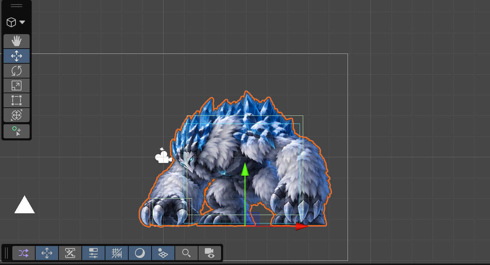
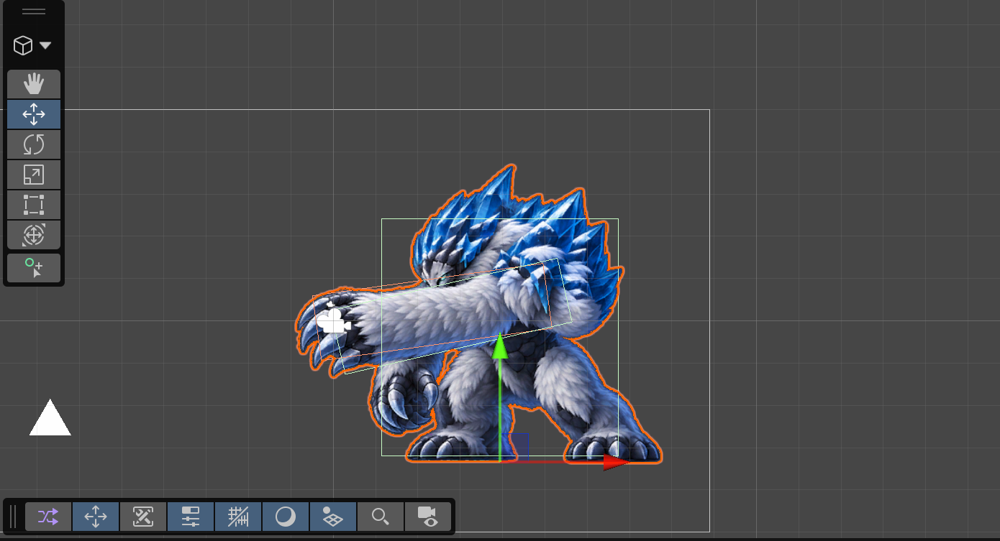
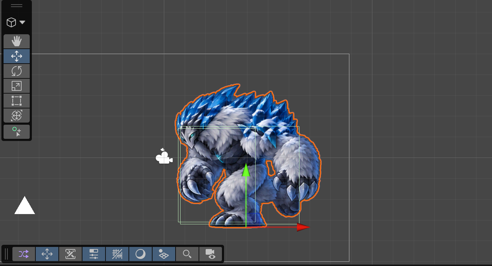

# 설산 거인 콜라이더 v01

2026-09-23. 사용자 요청에 따라 MinsuScene의 보스 콜라이더 작업을 진행했다.
기존 콜라이더 삭제가 허용되었으며, 모든 판정은 Trigger와 기존 Boss 태그·레이어를 사용한다.

## 적용 결과

원본 [Boss_SnowGiant 프리팹](../../Assets/03.Prefabs/Boss/Boss_SnowGiant.prefab)에 적용하여
MinsuScene의 인스턴스와 이후 생성할 보스에도 같은 계층이 생긴다.
씬의 기존 BodyHitBox, LeftArm, RightHand 자식은 제거했다.
보스의 위치 (3.94, -3.34), Scale (1, 1), 기존 Animator Controller는 유지했다.

```text
Boss_SnowGiant
├─ Rigidbody2D: Kinematic, Gravity Scale 0, Freeze Rotation
├─ BossColliderRig
└─ Colliders
   ├─ Hurtbox       : 몸통·머리·다리 중심의 피격 범위
   ├─ SlamHitbox    : 내려치는 손
   ├─ SwingHitbox   : 가슴 앞에서 휘두르는 팔
   └─ ChargeHitbox  : 돌진 중 전방 범위
```

네 콜라이더 모두 BoxCollider2D / Is Trigger ON / Tag Boss / Layer Boss(10).
팔이나 얼음 결정의 모든 외곽을 피격 범위로 따라가는 정밀 부위 판정은 아니다.
Hurtbox는 주요 자세별로 위치와 크기가 바뀐다. 공격 판정은 실제 타격 구간에만 켜진다.
좌표 기준은 기존 스프라이트의 512×512 셀, PPU 50, 하단 중앙 피봇이다.

## 활성 구간

종료 시각부터 판정은 꺼진다. 시각은 클립 내부 시간이며 Animator 속도에 따라 실제 소요 시간이 달라진다.

| 클립 | 공격 판정 |
|---|---|
| Idle / Walk / Hit | 모두 꺼짐 |
| Slam | 0.70 ≤ t < 0.85초: 하강 손 → 0.80초 지면 접촉 |
| Swing | 0.60 ≤ t < 0.80초: 휘두르기 → 끝까지 뻗기 |
| Charge 전체 | 0.70 ≤ t < 1.25초: 출발과 달리기, 제동부터 꺼짐 |
| Charge_Start | 0.70초부터 클립 끝까지 |
| Charge_Loop | 전체 구간 |
| Charge_End | 모두 꺼짐 |
| Death | 피격·공격 모두 꺼짐 |

10개 클립에 같은 네 자식의 Position X/Y, Rotation Z, Box Size X/Y, Enabled를 기록했다.
스프라이트 전환과 판정이 같은 자세에서 바뀌도록 Constant 키를 사용한다.
모든 클립에 비활성 판정의 초기값도 기록하여 이전 공격의 값이 남지 않게 했다.
이미지, 스프라이트 교체 키, 클립 길이·속도·반복 설정, 기존 전이는 변경 대상이 아니다.

## Unity에서 확인·조정

1. MinsuScene의 Boss_SnowGiant를 선택하고 Scene 창의 Gizmos를 켠다.
2. Animation 창에서 Boss_Slam / Boss_Swing / Boss_Charge를 선택하고 타임라인을 이동한다.
3. 보스 루트의 보조 Gizmo는 활성 피격 범위를 청록색, 활성 공격 범위를 주황색으로 그린다.
4. 세부 수정은 Animation 창을 보스에 고정하고 해당 Colliders 자식의 위치·회전·Box Size 키를 조정한다.
5. 플레이 중 기존 IsSlam / IsSwing / IsCharge / IsHit / IsDeath 트리거로 확인할 수 있다.

[BossColliderRig](../../Assets/02.Scripts/Boss/BossColliderRig.cs)는 실행 중 SpriteRenderer.flipX/flipY에
판정 계층을 맞춘다. 보스 부모의 음수 Scale은 이미 그림과 콜라이더에 함께 적용되므로 별도로 중복 반전하지 않는다.
Health.IsDead일 때와 실행 중 컴포넌트/오브젝트 비활성화 시 모든 판정을 끈다.
그림만 뒤집는 flipX에 대한 동기화는 실행 중 LateUpdate에서 이루어진다.

## 확인 결과

- Unity 실시간 상태에서 4개 Trigger, Boss 태그·레이어, 공통 Kinematic Rigidbody2D 연결 확인.
- 격리된 Preview Scene의 동일 보스에 10개 클립을 샘플링: 키 직전·직후를 포함한 225개 시점에서 활성 상태 일치.
- 동일 Animator에서 Slam 타격 → IsHit 전환: 공격 판정 해제 확인.
- 동일 Animator에서 Swing 타격 → IsDeath 전환: 피격·공격 모두 해제 확인.
- Charge 중 Health 사망 처리 후 판정 해제 확인.
- flipX 사용 시 공격 판정 중심이 X축 반대편으로 이동하고 Y는 유지되는 것 확인.
- 실제 Unity Scene 창에서 Slam, Swing, Charge 타격 자세를 겹쳐 확인.
- 검증용 Preview Scene과 오브젝트를 제거하고 Animation Preview를 종료한 뒤 Idle 상태로 저장.

[프레임 검사](unity-verification.json) · [Animator 전이 검사](animator-verification.json)

검증 도중 에디터의 Preview Scene에서 SendMessage로 LateUpdate를 강제 호출한 테스트가
Unity 내부 `ShouldRunBehaviour()` Assert 로그 2건을 남겼다. 게임 컴포넌트의 컴파일 오류는 아니다.
[수정한 테스트](verify-animator-command.cs)는 같은 메서드를 직접 호출하도록 바꾸었고,
재검사에서 모두 통과했으며 추가 Assert는 발생하지 않았다. 기존 Console 기록은 지우지 않았다.





## 남은 전투 연결

현재 MinsuScene의 플레이어 대역 Triangle에는 Collider2D가 없다.
실제 플레이어와의 접촉·회피·피해량·중복 타격 방지·고속 돌진 누락은 플레이어 충돌과 전투 로직 연결 후 검증해야 한다.
이번 작업은 콜라이더와 애니메이션 동기화이며 체력 감소 이벤트를 새로 구현하지 않았다.

모든 콜라이더가 요청대로 같은 Boss 태그·레이어를 쓰므로 태그만으로 공격/피격 역할을 구분할 수 없다.
후속 전투 코드에서는 BossColliderRig의 Hurtbox / SlamHitbox / SwingHitbox / ChargeHitbox 참조로 역할을 구분한다.
자식 Collider2D로부터 보스 체력이 필요하면 GetComponentInParent<Health>()로 루트의 Health를 찾는다.
한 공격에서 여러 접촉 이벤트가 오더라도 같은 대상에게 반복 피해를 주지 않는 처리는 후속 전투 로직의 책임이다.

전부 Trigger이므로 바닥·벽에 물리적으로 막히지 않는다. Kinematic Rigidbody2D는 판정의 물리 소속을 제공하며,
기존 BossMovement의 Transform 이동은 유지했다. 이번에 이동·중력·접지 방식을 변경하지 않았다.

## 보존·재현 자료

- [Backup/MinsuScene_before.unity](Backup/MinsuScene_before.unity): 작업 직전 저장되지 않았던 변경까지 포함한 씬 사본.
- Backup/Assets: 수정 전 프리팹·10개 클립·컨트롤러와 meta.
- [collider-layout.json](collider-layout.json): 모든 자세의 판정 좌표와 활성 상태.
- [build_setup.py](build_setup.py): 검토 좌표로 Unity MCP용 설정 명령 생성. 실행만으로 Unity 에셋은 바뀌지 않는다.
- Commands/00-rig.cs: 최초 계층 구성 명령. 이미 Colliders가 있으면 중복 설치하지 않고 중단한다.
- Commands/01~05-clips.cs: 판정 애니메이션 곡선 갱신 명령. 실행에는 Unity Editor/MCP가 필요하다.
- [verify-command.cs](verify-command.cs): 격리된 Preview Scene에서의 샘플 검사 명령.

Backup은 Assets 밖의 보관용 사본이며 Unity에 중복 임포트하지 않는다.
