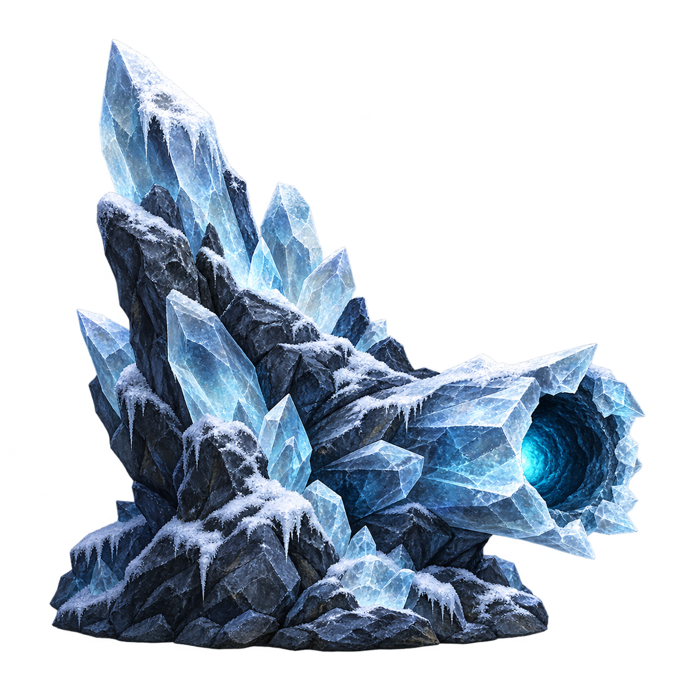
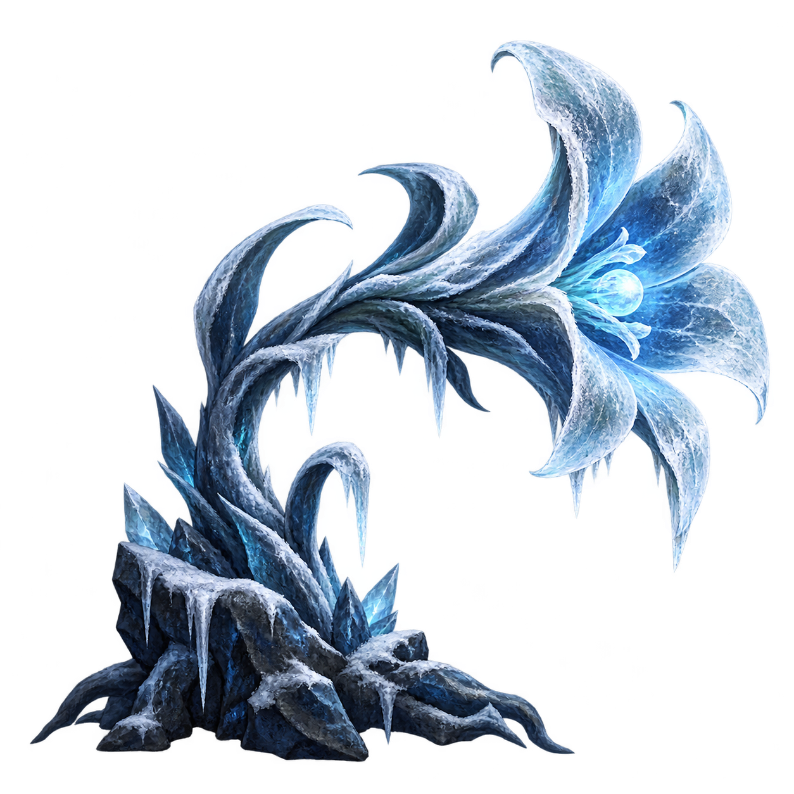
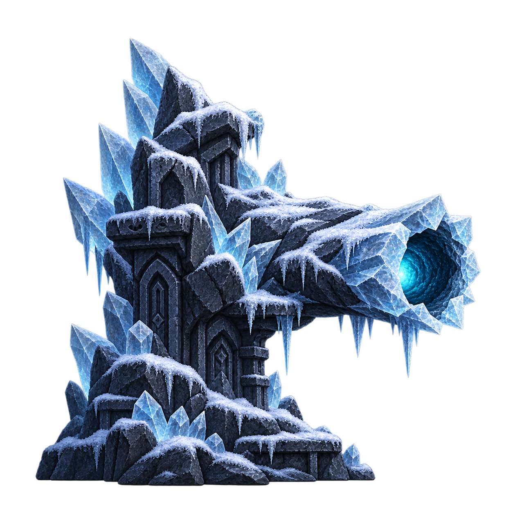
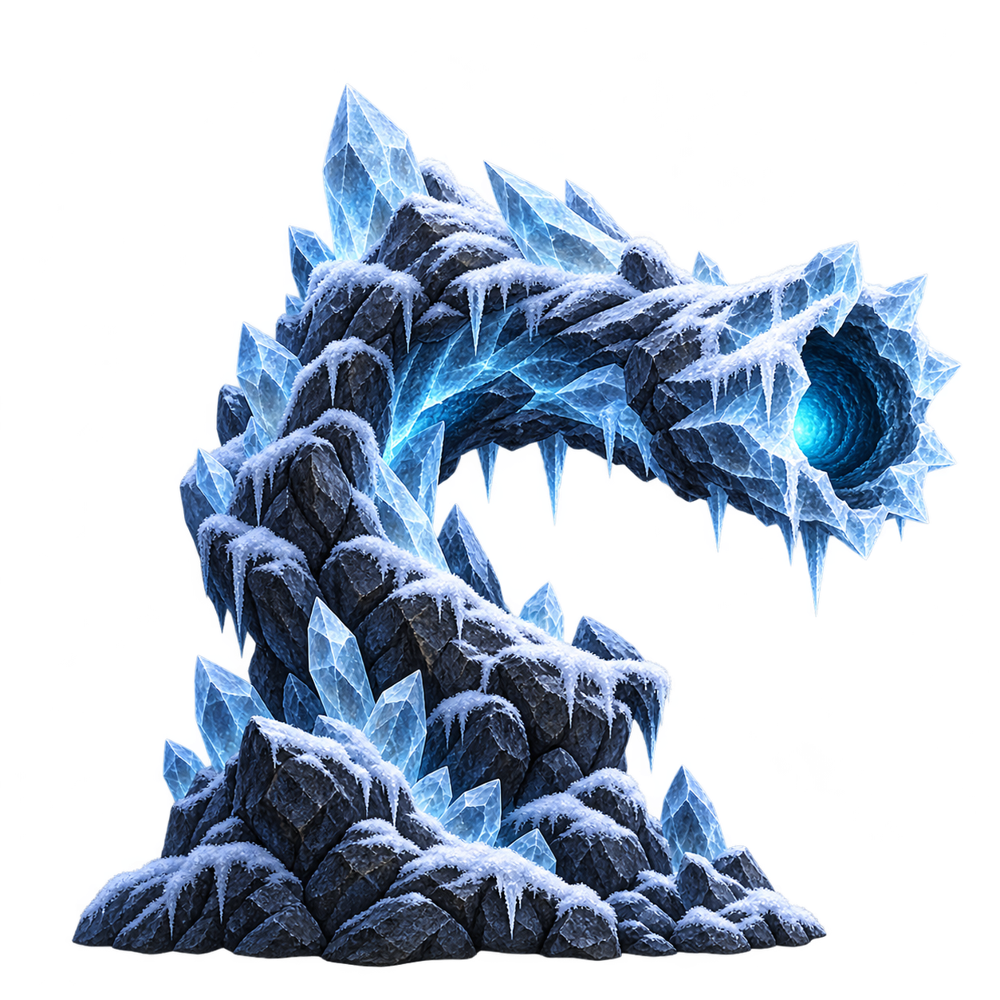
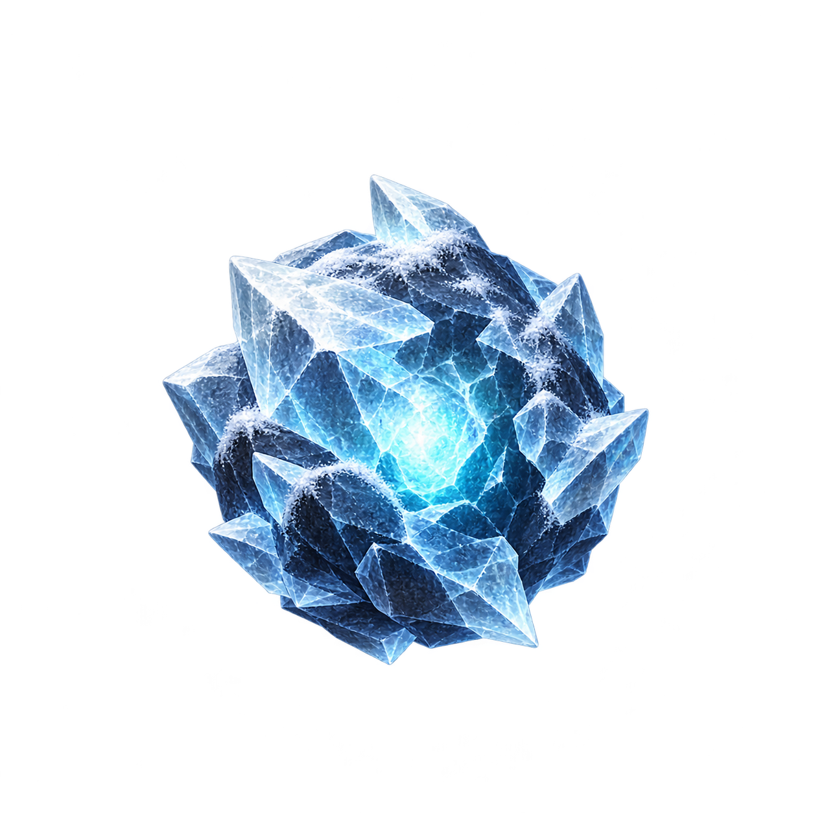
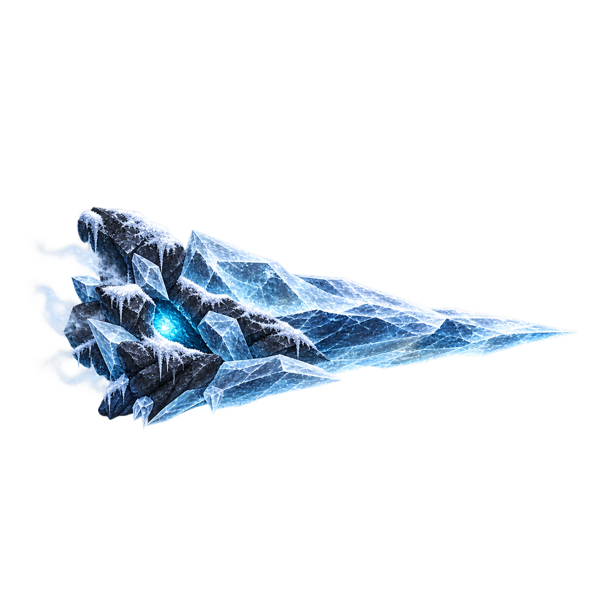
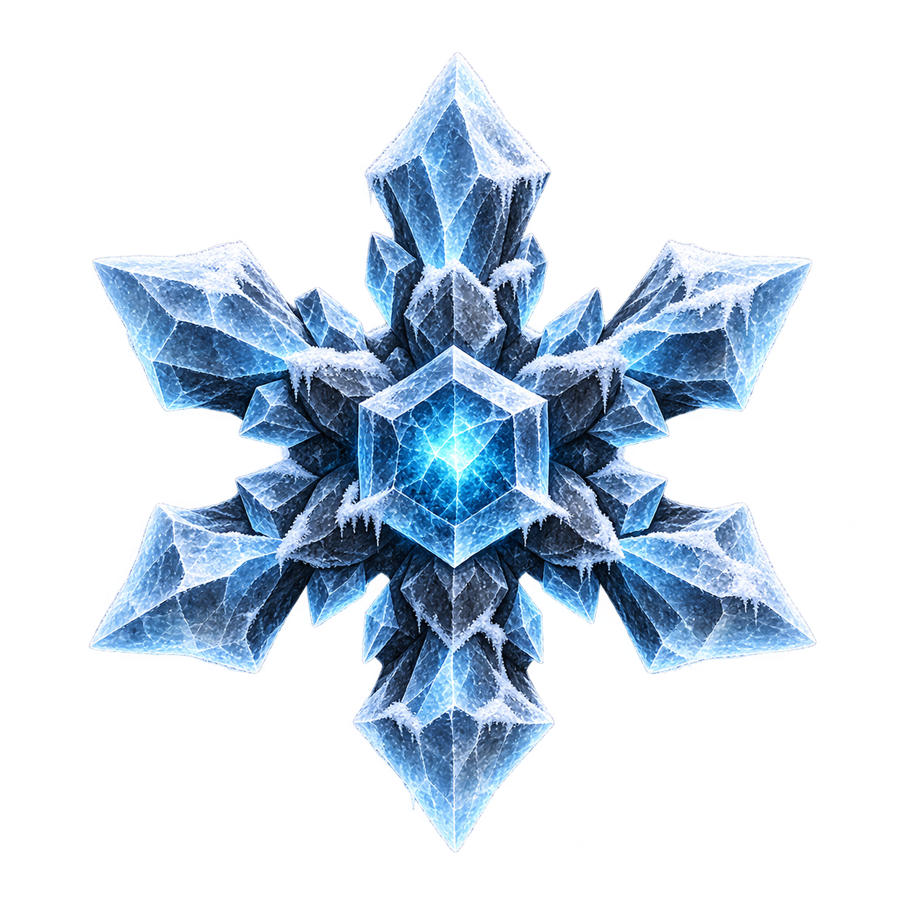
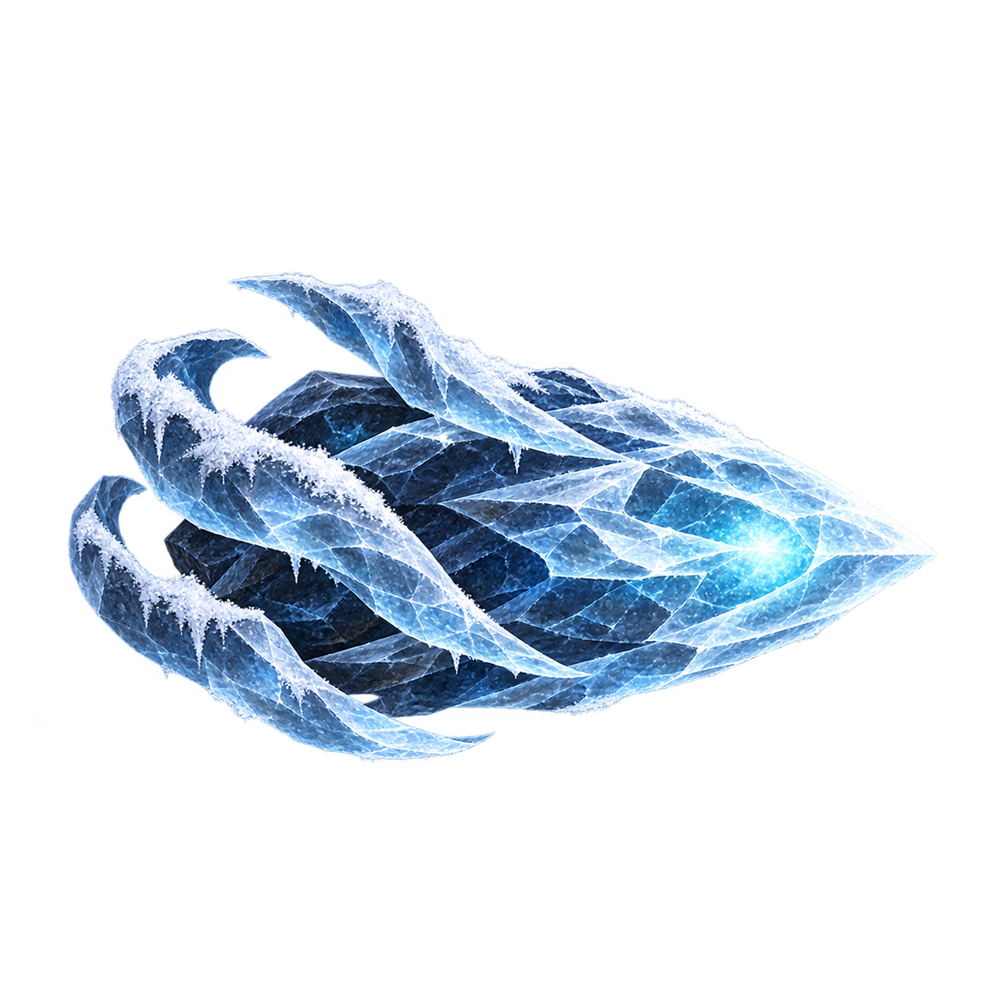

# 얼음 발사기·투사체 시안 8종

2026-10-09 · 개별 투명 PNG · 실제 1254×1254 · 사용자 선택 전 검토 시안

## 발사기

| 1 · 수정 광맥 | 2 · 서리 꽃 | 3 · 석조 분출구 | 4 · 나선 얼음뿔 |
|---|---|---|---|
|  |  |  |  |

## 투사체

| 1 · 얼음 구슬 | 2 · 고드름 창 | 3 · 눈꽃 결정 | 4 · 서리 씨앗 |
|---|---|---|---|
|  |  |  |  |

[제작 프롬프트와 참고 이미지](GenerationNotes_v01.md)

PNG 원본을 그대로 보존했으며 Unity Assets에는 추가하지 않았다. 시안은 별도 선택 가능하며 현재 Unity 씬에서의 크기·가독성·합성은 미검증이다.

