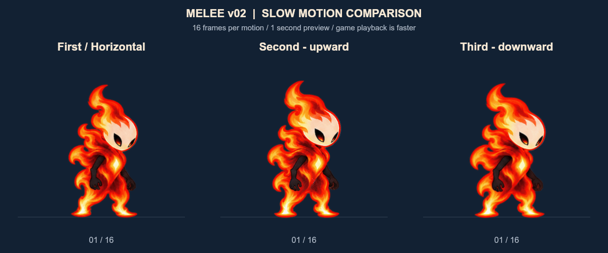

# 근접 공격 v02 제작·적용 기록

2026-10-14. 승인된 SecondAttack의 주먹 불꽃 표현에 맞춰 FirstAttack과 ThirdAttack을 제작하고, 주 플레이어 및 Hyunseo용 공격 클립에 적용했다. FirstAttack과 HorizontalAttack은 같은 스프라이트를 사용하며 클립 이름과 각 재생 시간은 유지한다.

| 공격 이름 | 프레임 | 동작 | 이미지 |
|---|---:|---|---|
| FirstAttack / HorizontalAttack | 16개 공유 | 팔을 뒤로 준비한 뒤 앞을 가로질러 휘두르고 회수 | [FirstAttack_v02](../../../Assets/04.Sprites/NewPlayer/FirstAttack_v02) |
| SecondAttack | 16 | 아래에서 머리 위로 휘두르기 | [SecondAttack_v02](../../../Assets/04.Sprites/NewPlayer/SecondAttack_v02) |
| ThirdAttack | 16 | 머리 위에서 앞으로 내려 휘두르기 | [ThirdAttack_v02](../../../Assets/04.Sprites/NewPlayer/ThirdAttack_v02) |

고유 이미지는 총 48개이며 이번에 새로 제작한 것은 First·Third 32개다. 불꽃은 휘두르는 손의 주먹에 붙이고 검은 팔을 드러냈다. 세 모션 모두 512×512 RGBA, PPU 200, torso pivot (270,226), Bilinear, 무압축, mipmap 없음이다. 기존 HorizontalAttack_v02의 주먹지르기 시안은 이력으로 남아 있으며 현재 HorizontalAttack 클립은 FirstAttack_v02를 참조한다.

GIF는 각 동작을 1초에 보여준 뒤 0.5초 대기하는 느린 비교본이다. 현재 주 컨트롤러의 실효 재생 시간은 First 약 0.222초, Second·Third·Horizontal 각각 0.25초다. GIF의 동일 속도를 게임 속도로 해석하지 않는다.

## 제작 자료

- First: [더미 자세표](FirstAttack/PoseGuide.png), [프롬프트](FirstAttack/Prompt.txt), [생성 원화](FirstAttack/Generated.png), [선택 자세 수정 프롬프트](FirstAttack/Prompt_Repair.txt), [수정 원화](FirstAttack/Repaired.png), [프레임 비교](FirstAttack/Contact.png), [개별 GIF](FirstAttack/Preview.gif).
- Third: [더미 자세표](ThirdAttack/PoseGuide.png), [프롬프트](ThirdAttack/Prompt.txt), [생성 원화](ThirdAttack/Generated.png), [프레임 비교](ThirdAttack/Contact.png), [개별 GIF](ThirdAttack/Preview.gif).
- Second: [기존 제작 기록](../SecondAttack_v02/Review.md).

내장 image_gen으로 캐릭터와 자세표를 참조해 생성했다. First·Third 생성 시트의 실제 크기는 각각 1254×1254이며 First 선택 수정 시트는 2172×724다. 최종 512 프레임은 원화를 분리·정렬·크기 보정한 결과이며 프레임별 네이티브 512 생성으로 표시하지 않는다. First는 선택한 3개 자세를 다시 생성했고, Third는 내려치는 순서에 맞춰 원화 프레임 순서를 정리했다. 얼굴이 팔에 가려질 때 몸 전체가 커지지 않도록 원화 시트별 고정 배율을 사용했다.

## 연결과 검증

[ApplyVerification.json](ApplyVerification.json): 주 플레이어의 First·Second·Third·Horizontal 4개와 Hyunseo의 LeftHorizontalAttack·LeftLookUp·DownAttack·RightHorizontalAttack 4개, 총 8개 클립에 연결했다. 각 클립의 16개 키를 Editor에서 샘플링한 128건이 통과했다. 클립 GUID, 설정, 이벤트, 기존 길이를 보존했다. 16프레임을 기존 길이에 맞추기 위해 필요한 sample rate만 조정했다. 컨트롤러·공격 데이터·판정 프리팹·게임 스크립트는 이 작업에서 수정하지 않았다.

[PlayVerification.json](PlayVerification.json): YuchanScene의 실제 PlayerController에서 64개 Animator 키가 새 스프라이트를 표시하는지 확인했다. 이어 운영 코드의 입력 이벤트를 통해 공격 4종을 실행해 새 모션 재생과 공격 오브젝트 생성을 모두 확인했다. 기록 중 오류·예외는 없었고 종료 상태는 Idle이었다. 이후 Play 모드를 종료했으며 씬 경로와 미저장 변경 없음 상태를 확인했다. 물리 키 입력과 적 타격 시점, 실제 전투 조작감까지 검증한 결과는 아니다.

[FinalAssetVerification.json](FinalAssetVerification.json): 48개 프레임의 해시·512 규격·알파를 확인했다. 10월 13일 기준 보호 파일 631개 중 627개는 그대로이며, HyunseoScene·MainTestScene·AudioManager.prefab·BossDamgeText.prefab 4개는 이번 이어가기 이전에 이미 Git에 반영된 변경이었다. 해당 파일을 덮어쓰거나 되돌리지 않았다. [Before](Before)에 이번 클립 변경 전 백업을 보존했다.

승인된 Second의 디자인을 바탕으로 나머지 제작과 적용을 완료한 상태다. First·Third의 최종 시각적 만족도와 실제 전투 감각은 사용자 확인 대상이다.
