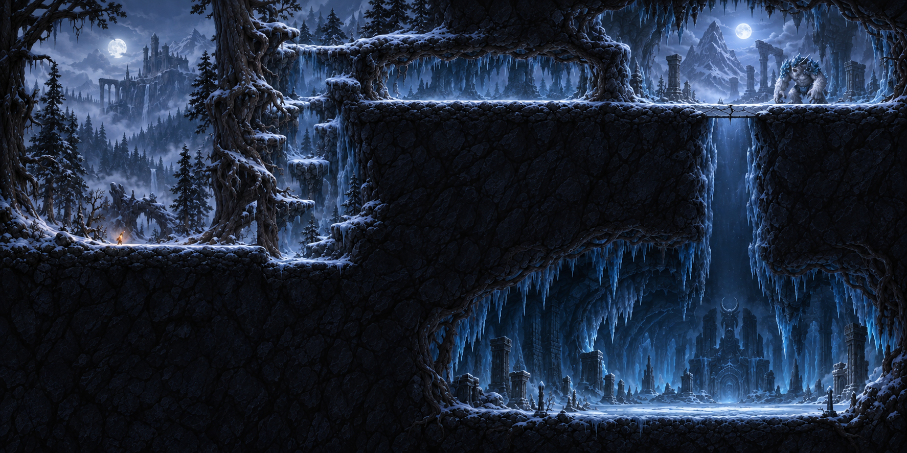
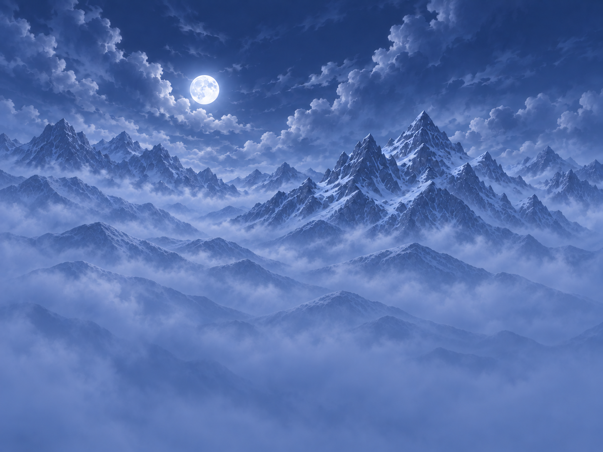

# 시작맵 최후방 배경 v01

## 제작 범위

- 기준: Assets/04.Sprites/Bg_Concept.png. 사용자가 지정한 공통 참조를 이미지 생성 도구에 직접 전달했다.
- 결과: Assets/04.Sprites/Backgrounds/StartMap/BG_Start_Far_v01.png
- 포함: 밤하늘, 구름, 달 하나, 먼 설산, 지면을 가리는 푸른 안개.
- 별도 제작 대상: 성·다리·성 아래 절벽, 침엽수 숲, 고목·가지·뿌리, 지형·발판·눈 덮개.
- 첫 결과에서 침엽수 실루엣이 섞여 발견되어, 달·구름·주요 산 구도를 유지한 채 숲을 제거했다.
- 이 파일은 시작맵용 첫 배경이다. 전체 맵을 덮는 최종 원경이나 이웃 구간과의 접합 검수가 완료된 파일은 아니다.
- Unity 씬과 게임 코드는 변경하지 않았다. 아직 다른 신규 레이어가 없으므로 레이어 합성 검수는 후속 소재 제작 시 진행한다.

## 실제 파일 및 설정

| 항목 | 값 |
|---|---|
| PNG 실제 크기 | 1448 × 1086 px, 4:3 |
| 색상 | RGB, 불투명 |
| 제작 방식 | 내장 image_gen, 참조 기반 생성 후 나무 제거 수정 |
| 확대 처리 | 없음 |
| PPU | 100 |
| Scale 1에서의 크기 | 14.48 × 10.86 Unity 유닛 |
| Sprite Mode / Mesh | Single / Full Rect |
| Pivot | 중앙 0.5, 0.5 |
| Filter / Mip Maps | Trilinear / On |
| Compression / Max Size | None / 2048 |
| Wrap | Clamp |
| Physics Shape | 생성 안 함 |

3072 × 2304로 생성 요청했지만 도구가 반환한 실제 이미지는 1448 × 1086이다. 이 파일을 네이티브 4K 또는 고해상도 최종본으로 표시하지 않는다. 장면의 실제 카메라 크기와 배경 표시 범위가 정해지기 전에는 전체 시작 구역을 덮을 권장 Scale을 확정하지 않는다. PPU를 낮추거나 Scale을 키워도 새 세부 묘사가 생기지 않는다.

## 이후 구간에서 유지할 기준

전체 공간 순서는 시작 → 등반 → 보스전 통로 → 상부 보스전 → 낙하 → 하부 동굴이다. 이번 하늘·설산은 이 중 시작 지역 배경이다. 상부 설산으로 이어지고 낙하부터 동굴 원경으로 전환되는 전체 위치 관계를 Bg_Concept에서 계속 확인한다.

- 항상 Bg_Concept와 사용자 확인을 받은 직전 소재를 함께 참조한다. 이 v01은 아직 사용자 확인 전이다.
- 원본의 차가운 청색·회청색과 은빛 달빛, 설산의 각진 능선, 손그림 묘사를 유지한다.
- 첫 생성 결과를 재설계하지 않고 산에 섞인 나무 부분만 수정했다.
- 다음 등반 구간은 이 이미지의 오른쪽 가장자리에서 구름·능선·안개를 이어서 제작한다. 이번 이미지를 수평 반복 타일로 사용하지 않는다.
- 달 위치는 이 지역 내 한 번만 사용하고, 연결 구간에 달을 추가하지 않는다.
- 원경 구조물인 성과 숲은 이 파일에 합치지 않고 각각 별도 소재로 만든다.
- 전체 맵 레이아웃의 암벽 윤곽, 성소, 캐릭터와 보스는 배경 소재에 포함하지 않는다.
- 연결부 일치와 플레이 화면에서의 선명도는 실제 이웃 소재와 표시 범위가 생긴 뒤 확인한다.

## 비교

원본 기준:

시작맵 최후방 배경:

## 최종 제작 프롬프트 기록

### 최초 참조 기반 생성

Use case: background-extraction.
Asset type: a single opaque background sprite for the START AREA of a 2D hand-painted snowy metroidvania.

Input image 1 is the authoritative Bg_Concept map artwork. Derive a separate farthest background plate from the LEFT STARTING FOREST AREA of this exact image, reconstructing the far scenery hidden by its foreground. This is a layer separation and reconstruction of that environment, not a redesign and not a complete game scene.

SOURCE REGION AND INVARIANTS:
Study approximately the left 36% of the reference, from the top down to the snowy starting ground. Match that region's cool slate blue and moonlit silver palette, painted cloud forms, quiet atmospheric mountain shapes, fine hand-painted rendering, lighting softness, and nighttime values. The distant scenery is pale and hazy compared with the near-black trees and rock of the source. Keep the same established visual language, rather than realistic astrophotography, stylized vector art, or pixel art.

OUTPUT:
ONE landscape 4:3 image, target 3072 x 2304 pixels at the highest available native detail, full-bleed opaque PNG. The subject is ONLY the farthest scenery: night sky, distant clouds, one small full moon, and very distant snowy mountain ridges receding into blue mist. The new canvas covers the start area's backdrop plus a little continuation to the right for the adjoining climbing area.

COMPOSITION:
Maintain the spatial feel of the original starting area. A small silver-white moon sits around x=35%, y=18%; its diameter about 6% of the canvas width. Moon halo restrained, moon surface delicately painted. The source-like snowy angular mountain shapes occupy the middle of the canvas and fade toward the bottom. Their highest peaks reach roughly y=30% to y=40%, with the moon and open cloudy sky above. Use several depth-separated mountain ridges with softer and paler distant silhouettes. The lower third dissolves gradually into cool atmospheric blue mist suitable for overlaying the future forest. The rightmost 15% continues the same cloud banks, mountains, and mist calmly so the next background can be extended from it. Avoid a dark frame or a focal object at the right edge.

LAYER EXCLUSIONS:
Remove and reconstruct behind ALL tree trunks, branches, pine trees, shrubs, roots, castle, bridge, towers, ruins, sanctuary, pillars, statues, cave ceilings and walls, foreground cliffs, ground, ledges, platforms, walkable surfaces, snow caps, icicles, characters, boss, fire and UI. In particular, the distant castle and its distinct supporting cliff belong to a separate future sprite: do not paint them into this plate. Mountains may have snowy rock faces, but no close dark cliff or ground plane. Do not preserve the full reference's map silhouette or its two arena layout. No second moon, no text, labels, watermark, panels, borders, guides, transparency checkerboard, Milky Way, bright cyan glow, heavy starfield, sunset, daylight, or photography.

DELIVERY INTENT:
The resulting plate must look like the very back layer uncovered beneath the left portion of Bg_Concept, ready for the user to add the separate distant castle, forest, giant trees and terrain in front. Preserve coherent source colors and diffuse detail; avoid hard high-contrast mountain edges that compete with future gameplay foreground.

### 최종 수정: 숲 실루엣 제거

Use case: precise-object-edit.
Edit target: the attached starting-area far-background plate.

Make ONE correction to this image: remove EVERY pine tree, conifer, forest silhouette, and tree-covered ridge. These are a separate layer in the user's game, so absolutely no trees may be baked into this farthest background.

Replace the tree-covered middle and lower ridges with smooth, softly painted BARE distant snowy mountain shoulders receding into the same blue mist. Where tiny jagged black triangular teeth of trees are visible along a ridge, remove those teeth and reconstruct a natural bare mountain contour. The bottom third should be mostly subtle blue mist with only barely visible smooth distant mountain masses, not a forest.

Preserve the image's canvas and framing, moon size and exact position, clouds, main mountain peaks and snow details in the upper/middle distance, cool slate-blue palette, diffuse moonlight, hand-painted game-art style, and all composition outside the tree removal. Do not redesign the moon or main peaks. Retain sufficient detail and the original color atmosphere.

Deliver one full-bleed opaque 4:3 PNG at the highest available native detail. No trees anywhere, no vegetation, no castle, no bridge, no buildings, no pillars, no sanctuary, no foreground rocks, no platforms, no ground plane, no characters, no second moon, no text or guides.
