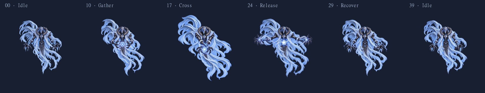

# AirBoss Cast CrossBurst v01 — 제작·검증 기록

2026-10-07. 사용자가 요청한 번개 구체를 다루는 새로운 전신 동작을 **총 40프레임**으로 제작했다. 작은 구체를 모아 낮은 X자로 팔을 교차한 뒤 양팔을 어깨 높이로 벌리고, 전류 잔상과 천의 후행을 남기며 Idle로 돌아온다.

[재생·프레임 탐색 미리보기](../../../ArtSource/AirBoss/cast_crossburst/review/index.html) · [무손실 APNG](../../../ArtSource/AirBoss/cast_crossburst/review/AirBoss_Cast_CrossBurst_v01_loop.png) · [전체 프레임 / 어두운 배경](../../../ArtSource/AirBoss/cast_crossburst/review/contact_dark_labeled.jpg) · [밝은 배경](../../../ArtSource/AirBoss/cast_crossburst/review/contact_light_labeled.jpg)

## 전달 파일

| Unity 파일 | 프레임 | 배열 | 실제 해상도 |
| --- | --- | --- | --- |
| [Part1](../../../Assets/04.Sprites/AirBoss/AirBoss_Cast_CrossBurst_Part1_4x4_1152_v01.png) | 00–15 | 4×4 | 4608×4608 |
| [Part2](../../../Assets/04.Sprites/AirBoss/AirBoss_Cast_CrossBurst_Part2_4x4_1152_v01.png) | 16–31 | 4×4 | 4608×4608 |
| [Part3](../../../Assets/04.Sprites/AirBoss/AirBoss_Cast_CrossBurst_Part3_4x2_1152_v01.png) | 32–39 | 4×2 | 4608×2304 |

각 PNG와 같은 이름의 .meta를 함께 보존했다. Unity에서 각 시트를 펼치면 AirBoss_Cast_CrossBurst_v01_00–39를 사용할 수 있다. 시트는 위쪽 행부터 왼쪽→오른쪽 순서다.

## 규격과 Idle 연결

- 최종 셀: **1152×1152 RGBA / PPU 24 / 셀 중심 피봇 (576,576)**.
- 새 작화 32장(04–35), 기존 Idle v02 원본 8장(00–03·12–15).
- 00–03은 Idle v02의 00–03, 36–39는 Idle v02의 12–15와 중앙 1024 영역의 RGBA 바이트가 동일하다.
- 마스터는 AirBoss_Idle_Master_image2.png, SHA256 B67EBB82308AB8FA7D8A5C74C10F59FD7761E7335303AEF3ACF6C2F22587D722.
- ImageGen 요청 1024×1024, 실제 생성 원본 1254×1254. 전체 정사각 캔버스를 1024로 동일 정규화한 뒤 사방 64px 투명 패딩을 더했다. Idle 원본에는 리샘플링 없이 같은 패딩만 추가했다.
- 패딩 전후의 중심 상대 좌표와 PPU를 유지했다. 프레임마다 실루엣을 잘라 맞추거나 위치·배율을 자동 보정하지 않았다.
- 실제 공격 광선은 포함하지 않는다. 전신에 가까운 구체, 손·팔 주변의 전류와 잔상만 포함한다.

## 동작 시간 제안

00–03 Idle 0.30초 → 04–09 준비 0.45초 → 10–17 교차·압축 0.56초 → 18–21 최대 전조 0.36초 → 22–25 방출 0.16초 → 26–35 후행·복귀 0.75초 → 36–39 Idle 0.30초.

미리보기 합계 **2.88초**. 프레임 수와 재생 속도는 별개이며 이 시간은 검토용 제안이다. 공격 발사 후보는 22–24 구간이지만 실제 공격 이벤트나 판정 타이밍은 설정하지 않았다.

## 확인 결과

- 개별 RGBA 셀 40개, 서로 다른 픽셀 해시 40개.
- Idle 원본 8장의 중앙 1024 영역 바이트 일치.
- 모든 셀의 바깥 64px 완전 투명. alpha > 0 기준 최소 여백 64px.
- 시트 3장을 다시 해독하고 각 셀을 추출했을 때 개별 프레임의 RGBA와 전부 일치.
- Unity 6000.3.22f1: Multiple 총 40개, 연속 이름 00–39, Rect 1152×1152, 중심 Pivot·PPU 24, 실제 텍스처 해상도 확인.
- Max Size 8192, NPOT None, Uncompressed, Bilinear, Mipmap Off, Alpha Is Transparency, Full Rect.
- 생성된 Physics Shape는 모든 Sprite에서 0개.
- Unity Console 오류·경고 조회 결과 0건.
- 작업 전 보존 대상 171개 파일의 SHA256 비교: 변경 0개. 기존 애니메이션·씬·프리팹·AirBoss 스프라이트를 덮어쓰지 않았다.
- 밝은/어두운 배경의 40프레임 정적 비교를 수행했다. 교차 방향이 바뀌던 중간 자세, 너무 이른 팔 복귀, 손·구체 높이와 천의 크기가 튀던 연결을 재생성했다.
- APNG 40프레임의 압축 이미지 데이터가 개별 PNG와 동일함을 확인했다. HTML 스크립트 문법과 참조하는 40개 이미지의 존재·규격을 확인했다.

## 검증 범위와 보존

정적 아트, PNG 픽셀, 시트 배열 및 Unity 슬라이스 검증이다. 브라우저 제어 도구의 초기화 오류로 HTML의 실제 UI 재생 조작은 검증하지 못했다. Unity 게임 화면 재생, 임의 Idle 시점에서의 전환, 실제 공격 패턴과의 연결 및 최종 아트 승인은 별도다.

**AnimationClip·Animator·Collider·씬·프리팹·게임 코드는 만들거나 변경하지 않았다.** Assets/04.Sprites/Boss도 변경하지 않았다. 제작 원본과 포장/검토 도구는 Assets 밖 ArtSource에 보관했다.

미압축 RGBA8 텍스처의 합계는 약 202.5MiB(밉맵 제외)다. 다른 플랫폼의 텍스처 제한·압축 정책과 실제 메모리 사용량은 별도 검토 대상이며, 이번에는 해상도 보존을 우선했다.

[개별 제작 기준·타이밍](../../../ArtSource/AirBoss/cast_crossburst/CrossBurst_Production_v01.md) · [생성 원본 출처](../../../ArtSource/AirBoss/cast_crossburst/generation_provenance_v01.json) · [픽셀·여백 검사](../../../ArtSource/AirBoss/cast_crossburst/validation_v01.json) · [시트 재추출 검사](../../../ArtSource/AirBoss/cast_crossburst/sheets_v01.json) · [Unity 결과](../../../ArtSource/AirBoss/cast_crossburst/unity_validation_v01.json) · [기존 파일 보존 검사](../../../ArtSource/AirBoss/cast_crossburst/protected_after.json)

생성 원본 43개(재작화 이전 버전 포함), 최종 개별 셀 40개와 시트·.meta를 프로젝트 안에 보관했다. 실제 사용본 선택은 validation_v01.json의 source를 따른다. 프롬프트 전문은 개별 제작 기준 문서에 연결되어 있다.
