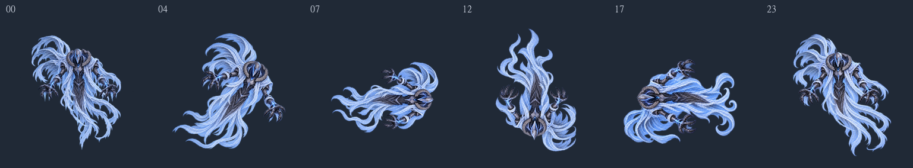

# AirBoss Cast_Spin360 v02 — 정면 유지 평면 회전 24장

2026-10-01. 사용자 요청에 따라 세로축 v01을 대체할 **정면 유지 평면 회전 v02, 24개 멀티 스프라이트**를 제작하고 Unity 임포트를 확인했다. Animation Clip·Animator·씬·프리팹·게임 코드를 생성하거나 변경하지 않았다. 기존 v01 PNG·meta·기존 애니메이션 참조는 그대로 보존했다.

[제작 기준](../../../ArtSource/AirBoss/cast_spin360/Cast_Spin360_Production_v02.md) · [공통 규칙 v1.4](../../../ArtSource/AirBoss/AirBoss_Multisprite_Production_Rules_v1.md) · [기획서 ANIM-07](../../../ArtSource/AirBoss/Aerial%20Boss%20Design%20Document%20v1.md)

## 결과 파일

| 파일 | 프레임 | 배열·실제 해상도 |
| --- | --- | --- |
| [Unity Part1 PNG](../../../Assets/04.Sprites/AirBoss/AirBoss_Cast_Spin360_Part1_4x4_1024_v02.png) 및 같은 이름의 meta | 00~15 | 4×4, 4096×4096 |
| [Unity Part2 PNG](../../../Assets/04.Sprites/AirBoss/AirBoss_Cast_Spin360_Part2_4x2_1024_v02.png) 및 같은 이름의 meta | 16~23 | 4×2, 4096×2048 |

모든 셀은 1024×1024 RGBA, Center (512,512), PPU 24다. 왼쪽 위부터 행 우선 순서이며 두 번째 시트도 이름은 16부터 이어진다. 시트 분할은 파일 보관 단위다. 셀 사이 간격과 시트 외부 패딩은 0이다. 실제 게임과 기존 클립은 자동으로 새 시트에 연결하지 않았다.

- [제작 시트 폴더](../../../ArtSource/AirBoss/cast_spin360/sheets/) · [개별 24개 셀](../../../ArtSource/AirBoss/cast_spin360/frames/v02/)
- [채택 생성 원본](../../../ArtSource/AirBoss/cast_spin360/source/v02/) · [40회 생성 원본·개별 프롬프트 이력](../../../ArtSource/AirBoss/cast_spin360/source/v02/history/)
- [프로젝트 상대 경로의 실제 프롬프트 전체](AirBoss_Cast_Spin360_v02.prompts.json) · [픽셀 측정](AirBoss_Cast_Spin360_v02.metrics.json) · [제작 요약](AirBoss_Cast_Spin360_v02.summary.json)
- [Unity 확인](AirBoss_Cast_Spin360_v02.unity.json) · [시트 해시·셀 일치](AirBoss_Cast_Spin360_v02.sheets.json) · [기존 파일 보존 검사](AirBoss_Cast_Spin360_v02.protected_after.json)

## 동작과 채택 순서

마스터와 기존 v01 비교 이미지 및 콘티를 실제 이미지로 확인했다. 최신 사용자 지시에 따라 **정면 가면·눈·흉갑을 보이는 상태로 화면 안에서 시계 방향으로 한 바퀴** 돈다. 머리 위 → 오른쪽 → 아래 → 왼쪽 → 위로 진행하며 측면·후면으로 바뀌지 않는다. 시계 방향은 이번 제작 선택이다.

| 프레임 | 최종 그림의 역할 |
| --- | --- |
| 00 | 고정 Idle 마스터 파일 그대로 |
| 01~06 | 작은 기울기에서 오른쪽 수평 직전까지 회전, 손목·천 후행 |
| 07 | 머리 오른쪽 수평 자세 |
| 08~11 | 머리가 오른쪽 아래로 진행하며 거꾸로 연결 |
| 12 | 거꾸로 된 정면 자세 |
| 13~15 | 머리 왼쪽 아래로 진행 |
| 16~17 | 왼쪽 수평 방향에 도달하고 팔·천의 후행 변화가 이어짐 |
| 18~20 | 머리가 왼쪽 위로 올라오며 복귀 |
| 21~23 | 몸이 세워지고 손과 천을 정리하며 Idle 연결 |

각도표는 생성 목표이며 모든 결과가 균등한 각도 간격으로 정밀 실측됐다는 뜻이 아니다. 16~17은 수평 방향 부근에서 손목·천이 달라지는 두 그림으로 채택했다. 24장에 동일한 노출 시간을 강제하지 않는다. 기존 약 3.6초는 기획 참고로 유지하며 이번에는 타이밍 키·클립·GIF/APNG·재생 타임라인을 만들지 않았다.

목표보다 기울기가 크거나 작은 후보는 실제 자세를 보고 순서를 조정했다. 요청 06의 초기 후보는 최종 05로, 요청 16의 한 후보는 최종 18로 사용했다. 프롬프트 기록의 `requestedFrame`과 `selectedFrame`을 구분한다. 잘못된 가면 방향·추가 신체·부족한 여백이 있던 후보는 제외하거나 다시 그렸다. 최종 채택은 생성 그림 23장과 원본 마스터 1장이다.

## 제작·보존 방식

내장 `image_gen.imagegen`으로 프레임별 생성·편집 40회를 수행했다. 생성 요청은 1024×1024였으며 실제 생성 원본은 모두 1254×1254다. 원본 전체 정사각 캔버스를 공통으로 1024에 정규화했다. 기존 마스터의 과거 72% 축소를 다시 적용하지 않았다. 생성 단계에서 잘못 커진 주요 자세의 체격, 가면 방향, 손목과 천 끝을 다시 그렸다.

Node sharp는 전체 캔버스 정규화·정적 비교·픽셀 검사·시트 조립에만 사용했다. 최종 포즈를 원본 PNG의 기계적 회전·좌우 반전·역순 복제·전신 잔상 중첩으로 만들지 않았으며, 개별 셀을 Trim·fit·재중앙 정렬하거나 프레임별 배율·위치로 보정하지 않았다. 조립은 RGBA 행을 정수 좌표에 복사하고 다시 추출해 비교했다.

분리된 alpha 1~7 연결 성분 중 512px 이하이고 alpha≥8 내용에서 16px를 넘게 떨어진 잡점만 정리했다. 최종 채택 셀의 정리 합계는 13,758px다. 연결된 반투명 천·발광은 보존하며 일괄 alpha 문턱 처리는 하지 않았다. 불필요한 둥근 빛 점은 ImageGen에서 제거했다. 원본 40장은 정리 전 상태로 프로젝트에 보존했다.

## 검증 결과와 한계

- 1024×1024 RGBA 24장, 서로 다른 SHA-256 24개. 00은 마스터 파일과 동일하다.
- 모든 alpha>0에 사방 64px 검사 통과. 최소 여백 64px, 범위 밖 픽셀 0개.
- 두 시트의 재추출 24개 셀이 개별 파일과 RGBA 완전 일치. 제작 시트와 Unity PNG 동일.
- 밝은·어두운 바탕 전체 프레임, 주요 자세, 시트 경계 14→15→16→17을 같은 셀 좌표에서 정적으로 비교했다.
- Unity 6000.3.22f1에서 Multiple 16+8개, 00~23 이름·순서·Rect 1024×1024·Center (512,512)·PPU 24 확인. 실제 해상도는 4096×4096 및 4096×2048, Max Size 4096, Uncompressed, Bilinear, Clamp, Mipmap Off.
- 보존 검사 1,101개 중 요청에 따라 갱신한 Idle 마스터 지침 문서 1개를 제외한 **1,100개 파일 해시가 동일**하다. 기존 씬·애니메이션·프리팹·코드·프로젝트 설정·Boss 및 기존 AirBoss PNG/meta는 변경하지 않았다.
- 임포트 후 콘솔에는 Unity AI 서비스 `NoSubscription` 오류 5개가 조회됐다. Sprite 임포트와 24개 슬라이스 검사는 성공했다. 구독·서비스 설정은 변경하지 않았다.

정적 아트와 임포트 검증을 실제 재생 검증으로 취급하지 않는다. 프레임별 세부 천 두께·주름·밝기·윤곽과 각도 간격에 생성 그림의 차이가 남는다. 특히 수평 자세 전후의 천 폭, 16~17 후행 구간, 복귀 구간은 후속 실제 재생에서 노출 시간과 함께 확인할 대상이다. 게임 크기·재생 자연스러움·사용자 최종 아트 승인은 미검증이다.

| 시트 | GUID | SHA-256 |
| --- | --- | --- |
| Part1 | `fafd123bbbfa40299db27044b8eebb7b` | `5281b062e2fb94b75e75c938fbe78c2d3d38b97a1dceb0c66851ae7ca30745e8` |
| Part2 | `5a4efaeda726431597fa7c0484468ec8` | `f96741a71cc6228c884ace1acfa6f8cf862bac4cdea2fffbd8a9f9e7b84c9a1d` |

## 정적 비교 이미지

[Part1 어두운 바탕](AirBoss_Cast_Spin360_v02_part1_contact_dark.png) · [Part1 밝은 바탕](AirBoss_Cast_Spin360_v02_part1_contact_light.png) · [Part2 어두운 바탕](AirBoss_Cast_Spin360_v02_part2_contact_dark.png) · [Part2 밝은 바탕](AirBoss_Cast_Spin360_v02_part2_contact_light.png) · [시트 경계](AirBoss_Cast_Spin360_v02_sheet_boundary.png)
