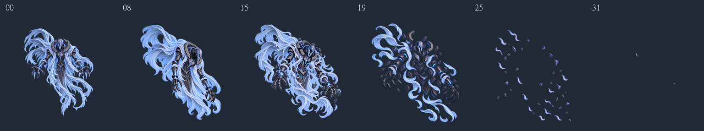

# AirBoss Death v01 제작·검증 기록

2026-10-01. 사용자 요청: 파편으로 흩어지는 Death **32프레임, 16장씩 2개 멀티스프라이트 시트**. **애니메이션 클립은 만들지 않는다.**

## 산출물

| 구분 | 파일 / 규격 |
| --- | --- |
| 첫 시트 00~15 | [Unity PNG](../../../Assets/04.Sprites/AirBoss/AirBoss_Death_Part1_4x4_1024_v01.png), 동일 위치 .meta |
| 둘째 시트 16~31 | [Unity PNG](../../../Assets/04.Sprites/AirBoss/AirBoss_Death_Part2_4x4_1024_v01.png), 동일 위치 .meta |
| 제작 시트 원본 | [death/sheets](../../../ArtSource/AirBoss/death/sheets) |
| 개별 프레임 32개 | [death/frames/v01](../../../ArtSource/AirBoss/death/frames/v01) |
| 생성 원본과 보완 이력 | [death/source/v01](../../../ArtSource/AirBoss/death/source/v01), history에 모든 생성본 보존 |
| 제작 지침 | [Death_Production_v01.md](../../../ArtSource/AirBoss/death/Death_Production_v01.md) |
| 실제 프롬프트·참조·채택 번호 | [prompts.json](AirBoss_Death_v01.prompts.json) |
| 픽셀 검사 / Unity 검사 | [metrics.json](AirBoss_Death_v01.metrics.json), [unity.json](AirBoss_Death_v01.unity.json) |
| 타이밍 참고 | [timing.json](AirBoss_Death_v01.timing.json) |

각 시트는 **4096×4096 RGBA, 4×4**, 셀은 **1024×1024**, 간격과 외부 패딩 0. Unity **Multiple 16개씩, 총 32개**, 이름은 `AirBoss_Death_v01_00`~`31`, **PPU 24 / Center (512,512)**. 위에서부터 왼쪽→오른쪽, 다음 행 순서로 배열했다. 둘째 시트는 16부터 시작하며 15→16에 중복 셀이나 정지 프레임을 추가하지 않았다.

Import 실제 확인: Max Size 4096, 실제 Texture2D 4096×4096, Uncompressed, Bilinear, Clamp, Mipmap Off. GUID: Part1 `3331926dca8f4b0c9d0fcef0f86f6814`, Part2 `1ca8bca0974548a2a31ed0ff58179e7d`.

## 동작과 노출 시간 제안

00은 현재 Idle 마스터 그대로다. 힘을 잃고 손목·어깨·고개가 처짐 → 몸이 기울며 기존 틈에 균열 → 가면·목 갑옷·흉갑·팔이 분리 → 천이 뒤늦게 찢어짐 → 작은 파편과 천 조각이 표류하고 옅어짐으로 구성했다. 단단한 갑옷 조각과 유연한 천 조각의 재질을 구분했다. 새 신체·피·살점·바닥 잔해·독립 공격 VFX는 추가하지 않았다. 마지막 31은 완전 빈 셀이 아니라 아주 작은 잔여 조각이 남는 그림이다.

사용자 합의인 **준비는 느리게, 분해 순간은 빠르게, 마지막 파편은 여운 있게**에 맞춘 약 4초 출발안이다.

| 프레임 | 1장 노출 | 구간 합계 | 역할 |
| --- | --- | --- | --- |
| 00~10 | 0.14초 | 1.54초 | 느린 힘 상실·기울어짐·균열 준비 |
| 11~19 | 0.06초 | 0.54초 | 빠른 분리·분해 |
| 20~23 | 0.10초 | 0.40초 | 분리된 조각의 확산 |
| 24~27 | 0.14초 | 0.56초 | 작은 조각·천의 표류 |
| 28~31 | 0.24초 | 0.96초 | 마지막 파편의 여운 |
| 전체 | 가변 | **4.00초** | 1회 종결, Idle 복귀 없음 |

첫 시트와 둘째 시트를 각각 2초로 고정하지 않는다. 이 표는 이미지의 노출 시간 제안이며 **클립을 만들거나 4초 실제 재생을 검증한 결과가 아니다**. 최종 리듬·종료 시점은 사용자의 클립 제작과 게임 화면 검토에서 조정한다.

## 생성·정규화·보완 이력

- 내장 image_gen **43회**, 최종 01~31에 31개 채택. 00은 마스터 원본 파일을 그대로 복사했다. 나머지 12개는 보완 전 원본 또는 미채택본으로 history에 보존했다.
- 요청 캔버스는 1024×1024였으나 실제 생성 PNG는 모두 **1254×1254**였다. 같은 정사각 캔버스 전체를 1024×1024로 등비 정규화했다. 개별 실루엣 fit, Trim, 재중앙 정렬, 체격 보정, 종횡비 변형은 하지 않았다. 과거 72% 마스터 축소를 재적용하지 않았다.
- 포즈 변화는 개별 이미지 생성으로 제작했다. 역순 복제, 좌우 반전, 전체 이미지 이동·회전, 반투명 전신 중첩으로 연결 프레임을 대체하지 않았다.
- 생성 의도 번호와 실제 포즈가 다를 때 처짐·분해 정도에 따라 순서를 조정했다. prompts.json의 requestedFrame과 selectedFrame을 구분한다.
- 안전 띠에 닿는 천 끝은 image_gen으로 안쪽·위쪽 곡선을 다시 그렸다. 손·천·발광을 잘라내거나 본체를 축소해서 여백을 만들지 않았다.
- 정규화 후 **전체 연결 성분의 alpha가 1~7이고, 512픽셀 이하이며, alpha≥8 내용과 16px 이상 떨어진 미세 잡점**만 제거했다. 전 프레임 합계 29,087픽셀. 연결된 천·발광과 반투명 가장자리는 보존했다. 모든 픽셀을 일괄 alpha 문턱 처리하지 않았다. 원본은 별도 보존되어 처리 내역을 추적할 수 있다.
- 빌드/검사 재현: [Build](Build_AirBoss_Death_v01.cjs), [외곽 성분 검사](Inspect_AirBoss_Death_v01.cjs), [자료 정리](Finalize_AirBoss_Death_v01.cjs). Node.js와 sharp를 사용하며 이미지 생성 API를 호출하는 스크립트가 아니다. source 파일만으로 시트를 다시 조립할 수 있다.

## 검증 결과와 범위

- 32개 셀 모두 실제 1024×1024 RGBA이며 SHA-256 32개 모두 고유하다.
- 00은 마스터와 파일 SHA-256까지 동일하다: `B67EBB82308AB8FA7D8A5C74C10F59FD7761E7335303AEF3ACF6C2F22587D722`.
- 모든 alpha>0 픽셀이 X/Y 64~959 안에 있다. 사방 최소 여백 **64px**, 안전 띠 바깥 픽셀 **0**.
- 시트에서 32셀을 다시 추출한 RGBA 픽셀이 개별 프레임과 동일하고, ArtSource 시트와 Unity PNG도 동일하다. [시트 해시](AirBoss_Death_v01.sheets.json).
- Unity에서 두 Texture2D의 해상도와 32개 Sprite의 이름·Rect·Pivot·PPU를 실제 조회하여 전 항목 확인했다.
- 밝은/어두운 접촉 시트와 14~17 경계 비교를 확인했다. 생성 그림 사이의 미세한 선·천 두께·파편 모양 변화가 남으므로 이 정적 검토를 실제 재생의 자연스러움이나 사용자 최종 승인으로 확대하지 않는다.
- 콘솔 조회 시 Unity AI 서비스 `generators.ai.unity.com`의 `NoSubscription` 로그 2개가 있었다. Death 두 시트의 임포트와 슬라이스 조회는 성공했다. 콘솔 전체 오류 0으로 기록하지 않는다.
- **클립·Animator·씬·게임 코드·전역 설정·Assets/04.Sprites/Boss는 변경하지 않았다.** 작업 시작 시 기존 파일 1,079개의 해시를 기록했으며 보존 비교 결과는 [protected_after.json](AirBoss_Death_v01.protected_after.json)을 따른다.
- 실제 Unity 애니메이션 재생, 공격/사망 상태 전환, 게임 크기, 마지막 표시 종료, 최종 아트 승인은 별도 검토다.

## 검토 이미지

[첫 시트 어두운 배경](AirBoss_Death_v01_part1_contact_dark.png) · [첫 시트 밝은 배경](AirBoss_Death_v01_part1_contact_light.png) · [둘째 시트 어두운 배경](AirBoss_Death_v01_part2_contact_dark.png) · [둘째 시트 밝은 배경](AirBoss_Death_v01_part2_contact_light.png) · [14~17 경계](AirBoss_Death_v01_sheet_boundary.png)

