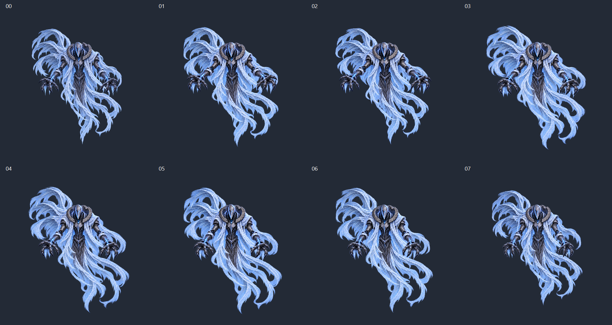

# AirBoss Idle 멀티스프라이트 v01

2026-09-30. 현재 1024 마스터를 기준으로 제작한 **8장 정적 검토본**이다. 사용자 요청에 따라 멀티스프라이트만 생성하고 애니메이션 클립·Animator·씬 배치는 만들지 않았다. 전체 그림을 먼저 확인받는 단계다.

## 결과 파일

- [Unity 멀티스프라이트 PNG](../../../Assets/04.Sprites/AirBoss/AirBoss_Idle_Float_4x2_1024_v01.png)와 [meta](../../../Assets/04.Sprites/AirBoss/AirBoss_Idle_Float_4x2_1024_v01.png.meta).
- [ArtSource 보존 시트](../../../ArtSource/AirBoss/idle/sheets/AirBoss_Idle_Float_4x2_1024_v01.png).
- [개별 프레임 폴더](../../../ArtSource/AirBoss/idle/frames/v01/): 00~07, 각 1024×1024.
- [생성 원본 폴더](../../../ArtSource/AirBoss/idle/source/Idle_Float_v01/): 내장 도구 출력, 1024 변환본, 미채택 07 첫 시도.
- [제작 규칙](../../../ArtSource/AirBoss/AirBoss_Multisprite_Production_Rules_v1.md), [기획서](../../../ArtSource/AirBoss/Aerial%20Boss%20Design%20Document%20v1.md).
- [전체 비교 — 어두운 바탕](AirBoss_Idle_Float_v01_contact_dark.png), [밝은 바탕](AirBoss_Idle_Float_v01_contact_light.png).

## 실제 사양과 Unity 확인

| 항목 | 결과 |
| --- | --- |
| PNG | 4096×2048, 8bit/channel RGBA, 실제 투명 alpha |
| 배열 | 4열×2행, 위 행 00~03 / 아래 행 04~07 |
| 셀 | 모두 1024×1024, 격자 간격·시트 외부 패딩 0 |
| Sprite Mode | Multiple |
| Sprite 수 | 8 |
| Pivot | 각 셀 Center, 픽셀 (512,512) |
| Max Size / 실제 임포트 | 4096 / 4096×2048 |
| 검토용 표시 설정 | Bilinear, Uncompressed, Mipmap Off, Clamp, Full Rect |
| PPU | 새 텍스처의 기본값 100을 유지. 최종 게임 크기 확정이 아님 |
| 자동 Physics Shape | 생성하지 않음, 각 Sprite 0개 |
| 에셋 GUID | f85b02a1c2b49214dbda6b1f9f52f983 |
| 애니메이션 클립 / Animator | 생성하지 않음 |
| Unity 씬 | 배치·저장하지 않음. 기존 MinsuScene의 미저장 상태 유지 |

Unity MCP로 실제 8개 Sprite의 이름·Rect·Pivot·해상도를 다시 조회했다. 반환 기록은 [unity JSON](AirBoss_Idle_Float_v01.unity.json)에 있다. PNG와 meta를 함께 보존한다.

## 제작과 보정

00은 현재 마스터 파일을 그대로 복사했으며 SHA-256도 동일하다: `B67EBB82308AB8FA7D8A5C74C10F59FD7761E7335303AEF3ACF6C2F22587D722`.

01~07은 마스터와 인접 주요 포즈를 참조하여 **내장 image_gen**으로 각각 제작했다. 07 첫 시도는 천이 너무 넓게 남아 채택하지 않고, 마스터에 가까운 복귀 상태로 다시 제작했다. CLI/API fallback은 사용하지 않았다. 실제 호출 프롬프트·참조 순서는 [prompts JSON](AirBoss_Idle_Float_v01.prompts.json)에 보관한다.

생성 요청은 1024 정사각형이었지만 실제 출력은 모두 1254×1254였다. **생성 캔버스 전체**를 동일한 1024/1254 비율로 변환했다. 외곽을 잘라 맞추거나 개별 체격·종횡비를 조정하지 않았고, 기존 마스터의 72% 축소를 반복하지 않았다. 00에는 변환을 적용하지 않았다.

생성 중 생긴 작은 위치 오차는 마스터의 고정 가면 영역을 같은 크기로 비교해 정수 픽셀 이동으로 보정했다. 외곽 중앙이나 천의 최대 크기를 기준으로 자동 중앙정렬하지 않았다. 이 보정은 의도된 부유 이동을 추가한 것이 아니라 캔버스 내 기준 위치를 맞춘 과정이다. 프레임별 보정량과 alpha 정리 수치는 [metrics JSON](AirBoss_Idle_Float_v01.metrics.json)에 있다.

가장자리 검사에서 발견된 희미한 점 중, **연결된 덩어리 전체의 alpha가 8 미만이고 실제 가시 영역(alpha≥8)에서 16px 넘게 떨어진 독립 덩어리만** 제거했다. 손·천·발광과 이어진 경계 및 주변 부분 투명도는 유지했다. 마스터 00은 alpha까지 수정하지 않았다. 정리 후 모든 alpha>0 픽셀의 사방 여백을 검사했으며 잘림 없이 통과했다.

조립은 RGBA 픽셀을 그대로 복사했고, 저장한 PNG를 다시 디코딩하여 각 셀이 개별 프레임과 동일한지 확인했다. 해상도 변환·위치 보정·분리 노이즈 정리·조립 과정은 [Inspect 스크립트](Inspect_AirBoss_Idle_Float_v01.ps1)와 [Build 스크립트](Build_AirBoss_Idle_Float_v01.ps1)에 기록되어 있다. 이들은 Docs의 재현용 이미지 처리 도구이며 Unity 프로젝트 스크립트가 아니다.

## 정적 검수

| 프레임 | 최소 투명 여백 |
| --- | --- |
| 00 | 84px |
| 01 | 100px |
| 02 | 117px |
| 03 | 84px |
| 04 | 78px |
| 05 | 70px |
| 06 | 78px |
| 07 | 116px |

- 셀·시트 크기와 RGBA, 64px 안전 여백, 8개 서로 다른 파일, 00의 마스터 일치를 확인했다.
- 조립 시트에서 읽은 각 셀과 개별 프레임의 픽셀 일치를 확인했다.
- 어둡고 밝은 바탕에서 정면 실루엣, 손, 높은 왼쪽 후면 천과 오른쪽 하단 천의 흐름을 비교했다.
- 전체 비교에서 열림·회복·이완·복귀의 차이가 보인다. 생성 프레임의 가면 균열·갑옷·천 세부는 00의 픽셀 복제가 아니므로, 미세 묘사와 천 변화량은 전체 아트 검토에서 확인할 대상이다.

## 검증 범위와 다음 단계

현재는 **전체 스프라이트 사용자 검토 대기**다. 파일·분할·정적 화면 확인을 3초 실제 루프의 자연스러움이나 최종 디자인 승인으로 확대 해석하지 않는다. 특히 8장·3초에서의 연결 속도와 07→00→01의 움직임은 아직 재생 검증 전이다.

애니메이션 클립·Animator·상태 전환·실제 게임 크기·보스 기능은 만들지 않았다. 사용자가 전체 스프라이트를 확인한 뒤 필요한 그림 수정을 하고 다음 범위를 진행한다.

