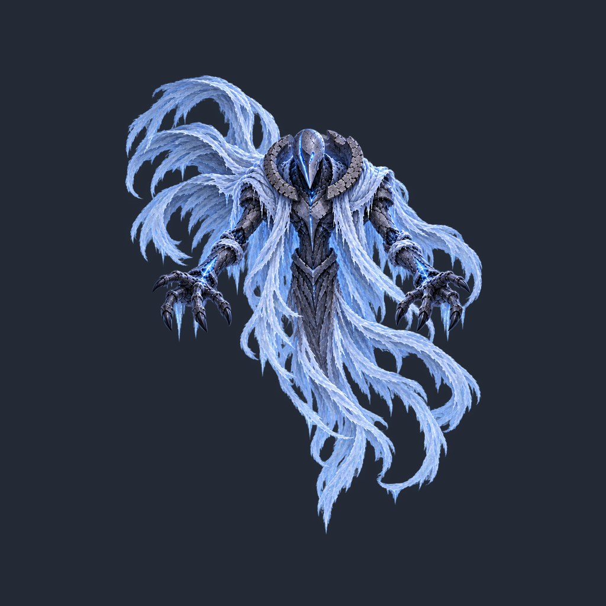

# AirBoss Idle image2 마스터 규격 조정 v02

- 작업일: 2026-09-30
- 요청: ArtSource/AirBoss 지침에 맞춰 지정된 Idle 마스터 1장을 수정.
- 적용 지침: [공중 보스 기획서](../../../ArtSource/AirBoss/Aerial%20Boss%20Design%20Document%20v1.md), [Idle 마스터 제작 지침](../../../ArtSource/AirBoss/idle/Master%20Crafting%20Guide%20for%20Aerial%20Bosses%20%28Idle%29%20v1.md).
- 현재 파일: [AirBoss_Idle_Master_image2.png](../../../ArtSource/AirBoss/idle/AirBoss_Idle_Master_image2.png).
- 동일 내용의 버전 보존본: [AirBoss_Idle_Master_image2_v02.png](../../../ArtSource/AirBoss/idle/AirBoss_Idle_Master_image2_v02.png).
- 수정 전 원본: [AirBoss_Idle_Master_image2_original_v01.png](../../../ArtSource/AirBoss/idle/source/AirBoss_Idle_Master_image2_original_v01.png).

## 반영 내용

확정된 정면 원본의 가면, 푸른 발광, 갑옷, 양팔·손, 천의 주요 갈래와 자세를 유지했다. 원본 전체 캔버스를 하나의 이미지로 등비 축소하고 투명 패딩을 추가했다. 부위별 재배치, 천 삭제, 새 장식, 비율 변형, 자동 Trim, 외곽 기준 자동 중앙정렬을 적용하지 않았다.

| 항목 | 실제 결과 |
| --- | --- |
| 원본 | 1254×1254 RGBA PNG |
| 최종 | 1024×1024 PNG, 8bit/channel RGBA, PNG color type 6 |
| 원본 전체에 적용한 배율 | 가로·세로 동일 0.72 |
| 원본 캔버스가 차지하는 목적 사각형 | (60.56, 60.56), 902.88×902.88 |
| 기준점 | 원본 캔버스 중심 (627,627) → 최종 (512,512) |
| 제작 Pivot 기준 | Center, 정규화 (0.5,0.5), 셀 왼쪽 아래 원점 (512,512) |
| 가면 위부터 가장 낮은 천 끝까지 | 시각적 기준 약 690px |
| 위쪽 후면 천까지 포함한 주요 외곽 높이 | 778px (alpha≥8) |
| 자동 Trim / 자동 외곽 중앙정렬 | 미사용 |
| PPU | 미확정 |
| Unity Import / 씬 | 변경하지 않음 |

가면보다 높은 기존 왼쪽 후면 천 고리는 그대로 보존했다. 따라서 “가면부터 천 끝”의 약 690px와 높은 후면 천을 포함한 전체 외곽 높이는 다르다.

픽셀 제작 좌표 변환은 아래와 같다. 같은 원점 관례를 사용하면 왼쪽 위 또는 왼쪽 아래 좌표계에서 모두 성립한다.

```text
x_final = 512 + 0.72 × (x_original - 627)
y_final = 512 + 0.72 × (y_original - 627)
```

가슴·가면은 셀 중심보다 위에 있다. 이후 프레임을 새 외곽 중심에 맞추거나 개별 축소하지 말고 이 배율과 기준 좌표를 출발점으로 사용한다. PNG 파일에 Unity Pivot 설정이 내장된 것은 아니며, 실제 임포트에서 Center를 적용할 기준만 기록했다.

## 실제 파일 검수

검수는 최종 경로에서 다시 읽은 PNG에 수행했다. 상세 수치는 [metrics JSON](AirBoss_Idle_Master_image2_v02.metrics.json)에 보관했다. 아래 bounding box는 **왼쪽 위 원점, 양끝 픽셀 포함**이다.

| 기준 | X 범위 | Y 범위 | 여백 (좌 / 우 / 상 / 하) |
| --- | --- | --- | --- |
| 모든 alpha>0 픽셀 | 131~935 | 84~910 | 131 / 88 / 84 / 113px |
| 주요 외곽 alpha≥8 | 211~814 | 126~903 | 211 / 209 / 126 / 120px |
| alpha≥128 | 212~814 | 127~900 | 212 / 209 / 127 / 123px |

- 현재 Idle 전체의 비투명 픽셀은 64px 안전 영역 안에 들어간다.
- 완전 투명 픽셀 800,852개, 부분 alpha 픽셀 245,718개, 완전 불투명 픽셀 2,006개. 원본의 부분 투명도를 유지했으며 단색 배경이나 체커 무늬를 넣지 않았다.
- 손끝, 천 끝, 정면 가면과 기존 비대칭 실루엣을 실제 이미지로 확인했다.
- 축소에는 System.Drawing의 HighQualityBicubic 보간을 사용했다. 원본 해상도 향상이나 새 세부 묘사 생성이 아니다.
- 현재 경로와 v02 보존본은 SHA-256이 동일하다.
- 원본 SHA-256: `35C21F509B9969371D92EDDCA03CD0D173C7A6C4418183BCB80BBCD5284DAABF`
- 최종 SHA-256: `B67EBB82308AB8FA7D8A5C74C10F59FD7761E7335303AEF3ACF6C2F22587D722`

### 미검증 범위

최대 양팔 상승, 정면 손 뻗기, 천이 펼쳐지는 회전·대시·사망 포즈는 아직 제작하지 않았다. 현재 Idle의 여백을 해당 포즈 전체의 검증 완료로 확대 해석하지 않는다.

현재 Idle 주요 외곽(alpha≥8)의 Center 기준 최대 반경은 약 439.49px로, 그 모습 그대로 회전하는 기하학적 계산에서는 약 72.51px의 여유가 남는다. 다만 원본에서 보존한 극미세 alpha 흔적까지 포함하면 최대 반경이 더 크다. 새로운 동작에서의 팔·천 확장과 모든 alpha 픽셀의 회전 안전성을 보장하는 결과는 아니다. 필요하면 최대 포즈 비교 후 공통 체격을 조정한다.

애니메이션 시트, Unity 테스트, PPU 확정 및 사용자 최종 승인은 이번 작업의 완료 항목에 포함하지 않았다.

## 검토 이미지

아래는 투명 PNG를 어두운 단색 위에 표시한 **검수용 이미지**다. 실제 마스터에는 이 배경이 없다.



## 편집 도구와 프롬프트 이력

내장 image_gen 편집 도구를 한 번 사용했고 CLI/API fallback은 사용하지 않았다. 생성 편집본에서 가면·갑옷·천 세부가 원본과 달라져 디자인 Lock 기준에 따라 채택하지 않았다. **최종 파일은 생성 편집본이 아니라 보존한 원본 픽셀에 위의 단일 등비 변환과 투명 패딩만 적용한 결과다.** AI 생성본의 일부를 합성하지 않았다.

내장 도구에 전달한 실제 프롬프트:

```text
Use case: precise-object-edit.
Asset type: locked-design Idle master sprite for the Emberveil aerial boss, one single whole-body sprite only.
Input image 1 is the EDIT TARGET and sole design/pose reference. This is a strict technical canvas/placement correction, not a new concept or design interpretation. Preserve its exact drawing, face, hands, pose, silhouette, and every major cloth strand as faithfully as possible.

Output a square 1024 x 1024 RGBA PNG with genuine transparent background. Place the existing complete original sprite on that canvas by uniformly scaling the WHOLE original 1254 x 1254 canvas to 72% (about 903 x 903) and padding equally by about 60.5 pixels on all four sides. Do NOT auto-trim or recenter based on the bounding box. Keep the original canvas center mapped to (512,512). This establishes a fixed production anchor; chest and face are naturally above that center.
This gives about 680-700px from mask top to lowest cloth tip, while retaining the existing higher left rear cloth loops above the mask. All fingers and cloth tips must remain in frame, leaving broad genuinely transparent room around the silhouette for future poses. Preserve the tall aspect ratio and the original asymmetrical cloth distribution: high looping strands on screen-left and long curled lower strands on screen-right.

LOCKED INVARIANTS: Preserve the same front-facing floating neutral Idle posture; elongated cracked white pointed mask and exact blue luminous slit arrangement; high curved segmented collar; dark segmented torso armor and icy blue seams; arm lengths; the exact existing hands, finger/claw counts, joint shapes, and open downward-facing hand gestures; all main attachment points and major divisions of the pale icy trailing cloth; palette, material texture, relative proportions, lighting and detail. No reposing. No redrawing or simplification of the mask, armor pattern or cloth. No independent adjustment or scaling of body parts. No new decorations or missing cloth strands. Only uniform whole-image reduction and transparent canvas padding.

No background color, scenery, floor, shadow, checkerboard painted into pixels, text, labels, borders, guide lines, crosshair, VFX, glow cloud, animation sheet, or additional characters. Return only the transparent single-sprite master, keeping all padding in the file.
```

## 수정 범위

지정 ArtSource PNG 교체, 원본 백업, v02 보존본, 이 검수 기록과 미리보기만 추가했다. 사용자가 편집 중인 두 기획 문서와 Assets/04.Sprites/AirBoss 및 Assets/04.Sprites/Boss는 수정하지 않았다. ArtSource는 Unity Assets 밖이므로 새 Unity .meta 파일을 임의로 만들지 않았다.

