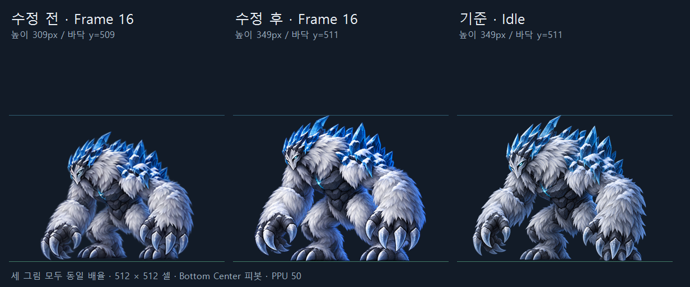

# IceThorn 복귀 크기 수정 — 2026-09-29

사용자 피드백: 마지막 프레임에서 Idle로 돌아갈 때 크기가 맞지 않는다.

## 원인과 수정

16번의 보이는 높이가 309px, Idle은 349px로 복귀 그림이 약 11.5% 작았다. 양쪽 모두 Unity 피봇 `(256, 0)`, PPU 50이며 루트 Scale 애니메이션은 없었다. Import 설정 대신 **13~16번 그림의 체격과 접지 기준**을 수정했다.

| 그림 | 수정 전 높이 | 수정 후 높이 | 수정 후 바닥 Y |
| --- | ---: | ---: | ---: |
| 13 | 303px | 359px | 511 |
| 14 | 294px | 358px | 511 |
| 15 | 303px | 354px | 511 |
| 16 | 309px | 349px | 511 |
| Idle 기준 | 349px | 349px (원본 유지) | 511 |

위 값은 셀 좌상단 원점, 알파 40/255 초과 픽셀의 외곽 범위다. 팔·몸의 자세가 달라 전체 높이도 달라질 수 있으므로 매 프레임 외곽 크기를 강제로 동일하게 맞추지 않는다. 13~16번에 같은 제작 배율과 접지 기준을 사용했고, 최종 16번의 높이를 Idle과 맞췄다. 16번 너비는 409px, Idle은 414px이며 복귀 자세의 손 위치 차이는 남는다. 복귀 그림을 Idle 원본과 픽셀 단위로 동일하게 만든 것은 아니다.

## 적용과 검증

- [실제 시트](../../../../Assets/04.Sprites/Boss/Boss_IceThorn_v3.png): 4096×1024 RGBA, 8×2, 셀 512×512, 고유 16프레임 유지.
- [픽셀 검증](Pixel_Verification.txt): 1~12번의 변경 픽셀 수 **0**. 13~16번만 교체했다.
- PNG `.meta`와 [기존 3초 클립](../../../../Assets/05.Animation/Boss/Boss_IceThorn_v3.anim)의 SHA-256은 수정 전과 동일하다. 기존 Sprite ID·GUID 참조가 유지되므로 클립에서 교체된 그림을 바로 사용한다.
- [Unity 검증](Unity_Verification.txt): 1.66/1.81/1.96/2.11/2.21/2.31초 샘플에서 피봇·PPU·Scale을 확인했다. 2.21초는 16번, 2.31초는 Boss_Idle_0이다.
- 같은 카메라·배율의 실제 렌더: [수정 전 16번](Unity_BeforeFrame16.png), [수정 후 16번](Unity_Frame16.png), [Idle](Unity_Idle.png). 체격 비교용으로 임시 프리팹의 중첩 VFX 표시만 숨겨 촬영했다.
- 15번·16번·Idle에서 팔/가시 판정과 VFX가 OFF인 것을 확인했다. 이펙트·콜라이더·클립 타이밍·프리팹·게임 스크립트는 수정하지 않았다.
- 임시 프리팹으로 Editor 샘플링했으며 사용자 씬은 변경하지 않았다. 종료 시 활성 씬 dirty=false, Console Error 0건. 실제 플레이 검증은 이번 범위에 포함하지 않았다.

## 제작과 재현

**내장 image_gen 편집 모드**를 사용했다. [최종 프롬프트](Prompt.txt), [생성 원본](../../../../ArtSource/Boss_IceThorn_v3/RecoveryFix/Generated_2x2.png), [편집 전 2×2 참조](../../../../ArtSource/Boss_IceThorn_v3/RecoveryFix/Before_Recovery_2x2.png)를 보관한다. Idle 원본을 체격·디자인 기준으로 제공했다.

요청한 작업용 크기는 1024×1024였고 실제 생성 결과는 **1254×1254 RGBA**였다. [PackRecovery.ps1](../../../../ArtSource/Boss_IceThorn_v3/RecoveryFix/PackRecovery.ps1)에서 네 프레임에 동일한 **0.724배**를 적용해 마지막 네 셀만 교체한다. 열 분리 X=642, 행 분리 Y=627, 행별 공통 접지선 Y=587/1165를 사용한다. 공통 열 원점·접지선으로 정렬하며 자동 Trim, 프레임별 Scale/중앙 재정렬을 사용하지 않는다.

원래 [PackSheet.ps1](../../../../ArtSource/Boss_IceThorn_v3/LiftRevision/PackSheet.ps1)에서도 마지막에 이 복귀 보정을 실행하도록 연결했다. 수정 전 PNG·meta·클립·13~16번은 [Before](Before/)에 참고용으로 보존한다. 검증용 조립·비교 PowerShell은 ArtSource에만 있으며 Assets에 게임 스크립트를 추가하지 않았다.
