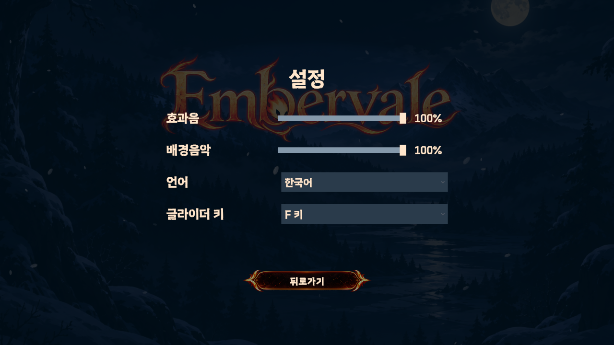
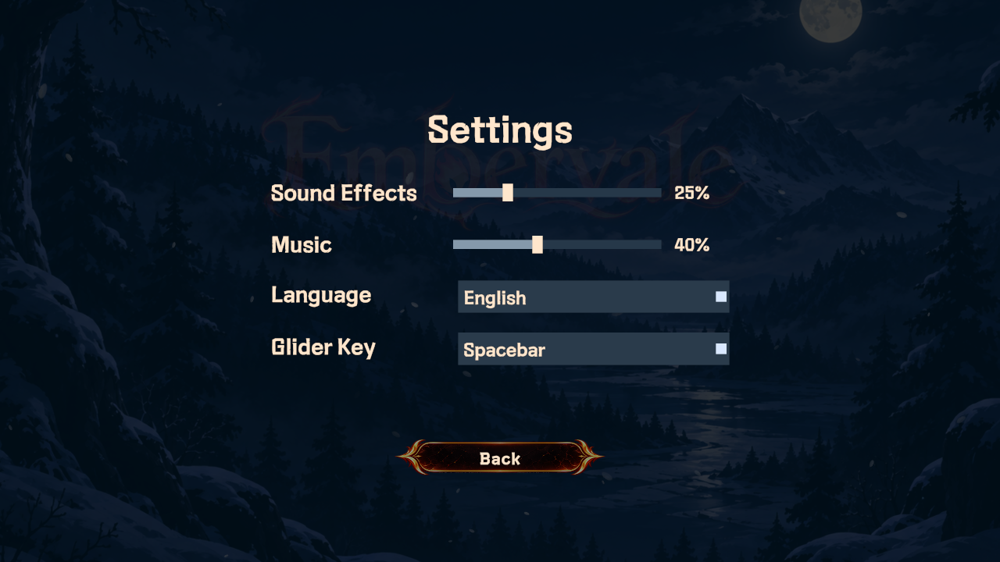

# 설정 화면 v01

2026-10-14. OutGameScene의 기존 설정 버튼과 뒤로가기 흐름에 연결했다.

## 사용

- 효과음 / 배경음악: 0~100%. 슬라이더를 움직이면 즉시 반영된다. 0%는 음소거다.
- 언어: 한국어 / English. Unity Localization의 SelectedLocale로 전환한다.
- 글라이더 키: F 키 / 스페이스바. 기본값은 기존 입력인 F다.
- 스페이스바 선택 시 남은 점프를 먼저 사용하고, 이후 입력으로 글라이더를 켜고 끈다. 벽에 붙어 있을 때는 벽 점프를 우선한다. 점프 수는 기존 PlayerJump 설정을 따른다.
- 설정 화면을 닫거나 앱이 일시정지/종료될 때 PlayerPrefs를 디스크에 저장한다. 새 게임 진행 기록과 설정 키는 별개다.

## 연결

- [GameSettingsPanel](../../../Assets/02.Scripts/UI/GameSettingsPanel.cs): 화면 컨트롤 연결과 표시.
- [GameSettings](../../../Assets/02.Scripts/UI/GameSettings.cs): 저장값과 설정 변경 이벤트.
- [GameSettingsRuntime](../../../Assets/02.Scripts/UI/GameSettingsRuntime.cs): 실행 시 자동 생성, 저장 언어 복원과 씬 오디오 연결.
- [SettingsAudioSource](../../../Assets/02.Scripts/Audio/SettingsAudioSource.cs): 원래 음량에 사용자 음량을 곱한다. AudioManager의 음악 레이어·엔딩 페이드 원래 음량은 별도로 유지한다.
- 신규 공유 효과음 프리팹에는 SettingsAudioSource를 연결한다. 동적으로 만든 AudioSource는 SettingsAudioSource.Bind로 연결하고, 원래 음량을 바꿀 때는 SetBaseVolume을 사용한다. 음악은 Category.Music으로 연결한다.
- 번역 데이터는 Assets/07.Datas/UI/Localization의 Menus 컬렉션에서 편집한다. 현재 번역 범위는 설정 화면, 메인메뉴, 난이도 메뉴, MainTestScene 일시정지 메뉴다. 게임 전체 HUD·강화 설명·연출 자막은 이번 번역 범위에 포함하지 않았다.
- com.unity.localization과 그 의존 패키지 및 AddressableAssetsData도 함께 공유해야 한다.

## 확인

- Unity 6000.3.22f1 코드 컴파일 및 커밋 훅과 동일한 `dotnet format 2d-team08.sln --verify-no-changes --include Assets/02.Scripts/` 검사 통과.
- 실제 OutGameScene Play 모드: 설정 열기/닫기/재진입, 닫힘 페이드 중 OutGameUI 비활성화·재활성화 후 메인 복원 확인.
- 뒤로가기 연결 수정: 설정 BackButton의 난이도용 OnClickBack을 OnClickCloseSettings로 변경. 버튼 위치의 EventSystem Raycast로 클릭 대상 확인 후 PointerDown/Up/Click 이벤트를 전달하여 설정 닫힘·메인 버튼 활성화·기본 버튼 선택을 확인했고, 설정 재진입 후 동일 경로를 한 번 더 확인했다. 난이도 화면의 뒤로가기 연결은 OnClickBack을 유지한다.
- 슬라이더 이벤트로 효과음 25%, 음악 40%를 설정. 실제 SFX AudioSource volume 0.25, TitleBgm 원래 음량 0.9 × 0.4 = 0.36 확인.
- 양쪽 0%에서 음소거 및 새로 생성한 PlayerJump VFX의 음소거 확인.
- 실행 중 만들어진 AttackOneShotAudio 채널은 설정 변경 시 즉시 음량 변경(0 → 0.5)을 확인.
- 음소거 중 엔딩 음악 페이드를 종료/취소한 뒤 음악 100% 복원 시 TitleBgm volume 0.9 확인.
- 한국어/영어 메뉴 표시, 글리프와 16:9 캡처, TMP 드롭다운 열기와 항목 Toggle 선택 확인.
- Play 종료 후 재진입에서도 영어와 음량 값 복원 확인. 검사 뒤 원래 PlayerPrefs 값과 키 존재 여부를 복구했다.
- 실제 Player 프리팹에서 Space 처리 메서드 호출로 점프 1/2회 → 글라이더 활성화 → 해제, F 옵션에서 Space로 글라이더 미활성화, 기존 F 글라이더 메서드 동작 확인.
- 번역 Addressables 콘텐츠 빌드 성공. Windows 플레이어 실행 파일 빌드는 수행하지 않았다.
- 실제 하드웨어 키 입력으로 전체 게임을 플레이하거나 청감으로 최종 믹스를 승인한 것은 아니다.

## 화면

