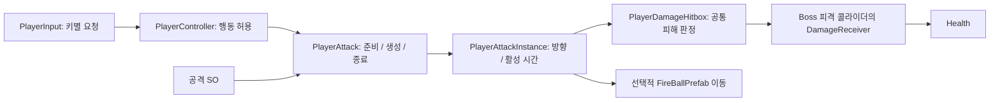

# 플레이어 공격 구조 정리 v01

2026-10-02. 팀 결정에 따라 Enemy 태그를 제거하고 Boss로 통일했다. 기존 분석은 [구조 검토](PlayerAttack_StructureReview_2026-10-02.md)를 참고한다. 이 문서는 실제 적용 후의 구조와 검증 범위를 설명한다.

## 적용 결과

- Dummy는 Boss 태그로 변경했다. 설인은 기존 Boss 태그를 유지한다. 피해를 받는 콜라이더에 `DamageReceiver`를 연결해 보스의 공격 콜라이더와 구분한다.
- 모든 공격은 동일한 `PlayerAttackInstance` 생성/초기화 경로와 `PlayerDamageHitbox` 피해 경로를 사용한다. 화염구의 이동·벽 충돌·페이드는 `FireBallPrefab`이 담당한다. 근접/원거리 종류나 콜라이더 존재로 실행 경로를 추측하지 않는다.
- SO는 작은 공격 정의로 유지한다. 키 입력, 중복 판정 Size, VFX/투사체 이중 연결을 제거했다. 런타임에 SO를 수정하지 않는다.
- `PlayerInput`이 키별 공격 요청을 보내고 `PlayerController`가 공격 가능 여부를 판단한다. 사망·피격·대시·다른 공격 중에는 새 공격을 시작하지 않는다.
- 점프 시작, 착지, 피격, 사망 시 근접 공격 판정을 중단한다. 이미 발사한 화염구는 플레이어 행동이 끝나도 자체 수명/접촉 규칙으로 동작한다. 취소 후 그림·효과음의 남은 재생은 허용한다.
- 이동 잠금은 소유자를 구분한다. 공격 종료는 공격 자신의 잠금만 풀고 넉백·벽 점프·대시·사망 잠금을 풀지 않는다.
- 공격 루트 Transform을 좌우 반전해 그림과 콜라이더를 함께 반전한다. 공격 프리팹 루트의 `VFXOffset`과 `VFXFlip`을 제거했다. 다른 이펙트에서 사용하는 해당 스크립트는 유지한다.
- 피해와 중복 타격 방지, Boss 피격 효과 호출은 공통 판정에서 처리한다. 한 공격 인스턴스는 같은 Health를 한 번만 타격한다. 사망 효과는 기존 대상 스크립트가 담당한다.
- `PlayerMeleeHitbox`, `PlayerVfxHitbox`, `PlayerAttackHitbox`, `IPlayerProjectile`, 과거 기본 데이터 생성기를 제거했다. enum의 Stab은 같은 직렬화 번호를 유지한 FireBall로 변경했다. 실제 참조되는 기존 애니메이션/컨트롤러 파일은 보존했다.
- EffectManager의 Boss 피격/사망 필드로 이름을 정리하고 기존 연결을 보존했다. MainTestScene, HyunseoScene, MinsuScene 및 EffectManager 프리팹의 제거된 공격 VFX 필드도 정리했다. 씬의 배치와 현재 열린 YuchanScene은 저장하지 않았다.

## 현재 실행 흐름

## Inspector에서 설정할 위치

| 바꿀 항목 | 설정 위치 | 의미 |
|---|---|---|
| 공격 키 | Player.prefab → PlayerInput → Attack Bindings | 키와 공격 SO의 연결. 보조 키는 제거된 상태를 유지한다. |
| 기본 피해 | 공격 SO → Damage | 생성한 인스턴스에 전달하는 값 |
| 생성 위치 | 공격 SO → Spawn Offset | 월드 단위. 플레이어 위치에 더하며 x만 방향에 따라 반전한다. |
| 생성 프리팹 | 공격 SO → Attack Prefab | 루트의 PlayerAttackInstance를 연결한다. |
| 공격 애니메이션 | 공격 SO → Anim Clip Name | 현재 Animator 상태 이름 |
| 준비 시간 | 공격 SO → Windup Duration | 애니 시작부터 공격 객체 생성까지 |
| 행동 회복 시간 | 공격 SO → Recovery Duration | 생성부터 다음 행동 허용까지 |
| 판정 활성 시간 | 공격 프리팹 → PlayerAttackInstance → Hit Delay / Hit Duration | 프리팹 생성 시점을 기준으로 하는 피해 구간 |
| 행동 종료 후 유지 | 공격 프리팹 → PlayerAttackInstance → Independent | 현재 화염구만 사용. 행동 종료/취소가 피해를 중단할지 결정한다. |
| 판정 모양 | 공격 프리팹의 Collider2D | Polygon 점, Capsule 크기 등 실제 모양. PlayerDamageHitbox의 Colliders 목록에 명시적으로 연결한다. |
| 시각만 보정 | 그림 전용 자식 Transform | 공격 루트에 추가 스폰 오프셋 컴포넌트를 붙이지 않는다. |
| 효과음 | 공격 프리팹의 기존 AudioSource / OneShotVFX | 연출 수명. 판정 시간이나 플레이어 행동 시간을 결정하지 않는다. |
| 새 적의 피격 부위 | 실제 피해 콜라이더의 Boss 태그 + DamageReceiver | Health를 연결한다. 공격용 콜라이더에는 DamageReceiver를 붙이지 않는다. |

공격 콜라이더의 내부 offset은 모양 중심을 맞추는 기능이므로 보존했다. SO Spawn Offset과 같은 역할로 사용하지 않는다. 공격 모양 디버그는 SO의 별도 박스 크기가 아닌 프리팹 Collider2D에서 그린다. Play Mode 표시의 bounds는 실제 활성 판정의 외접 박스다.

## 이관된 다섯 공격

기존 키, 피해 10, 월드 스폰 위치, 프리팹 스케일, 콜라이더 모양, 그림/소리 연결을 유지했다. 행동 회복 시간은 현재 Player Animator의 클립 길이와 상태 재생 속도를 읽어 맞췄다. 이전 0.22초에 끝나던 행동이 일부 공격에서 0.25초까지 지속된다. 판정 활성 시간과 효과음 길이는 이 변경에 따라 늘어나지 않는다.

| SO | 키 | Spawn Offset | 준비 | 행동 회복 | 피해 판정 |
|---|---|---|---|---|---|
| LeftHorizontalAttack | 1 | (0.8, 0.8) | 0초 | 약 0.221569초 | 0.22초 |
| RightHorizontalAttack | E | (0.8, 0.8) | 0초 | 0.25초 | 0.22초 |
| DownAttack | 2 | (0.2, -1.0) | 0초 | 0.25초 | 0.22초 |
| UpAttack | 3 | (0.2, 1.2) | 0초 | 0.25초 | 0.22초 |
| FireBallAttack | R | (1.1, 0.8) | 0초 | 0.25초 | 최대 2초, 명중/지형 접촉 시 조기 종료 |

화염구는 Rigidbody2D 이동과 이동 구간의 Collider2D.Cast로 얇은 대상/벽을 검사한다. 지형 처리는 Ground/Platform 태그에 적용한다. 후속 사용자 결정으로 Wall 태그를 제거했으며 화염구를 막을 고정 벽도 Ground로 지정한다. 생성 시 이미 겹친 지형만 겹침이 해소될 때까지 제외하며, 생성 후 만난 벽은 유예 시간으로 무시하지 않는다. 기존 속도 15, 거리 상한 32, 수명 2초를 유지해 시간 상한 기준 이동 범위는 약 30이다.

## 검증

Unity 6000.3.22f1의 실제 Editor에서 런타임/Editor 스크립트 컴파일, 자산 이관 후 검증을 완료했다. 별도 로컬 Physics2D 테스트 씬에서 **26개 Play Mode 검사 모두 PASS**였다.

- 다섯 공격 각각의 실제 콜라이더 bounds 좌우 반전, 시작/취소/잠금, 자연 종료와 판정 시간 분리.
- 준비 중 취소 시 객체 미생성, 실제 설인 Hurtbox 타격/중복 방지/공격 콜라이더 제외, 화염구의 공통 피해 처리.
- 다른 행동 잠금 보존, 착지/피격/사망 취소, 피격/대시/사망 중 공격 차단.
- 실제 PhysicsScene2D.Simulate의 트리거 피해 전달, 화염구의 얇은 벽 sweep 충돌.

시간 경계 검사는 내부 타이머를 진행시킨 후 실제 Update를 호출했다. 전체 플레이의 실시간 입력 순서, 애니메이션/효과음의 시각·청각 품질, 공중/벽 점프 모든 조합을 완주한 검증은 아니다.

결과: [자산 검증](PlayerAttack_Refactor_v01/AssetValidation.txt), [Play 검사](PlayerAttack_Refactor_v01/PlayRegression.txt), [최종 컴파일](PlayerAttack_Refactor_v01/FinalCompile.txt). 변경한 프리팹 9개의 Missing Script도 0개다. 검증용 com.unity.pipeline 패키지를 제거하고 원래 manifest/lock으로 복원한 후 런타임/Editor 어셈블리 재컴파일까지 성공했다.

다시 확인하려면 `Tools → Player → Validate Attack Setup`을 실행한다. Play Mode에서는 `Tools → Player → Run Attack Regression (Play Mode)`를 사용할 수 있다. 회귀 검사는 임시 테스트 씬과 객체를 만들고 정리하며 현재 씬을 저장하지 않는다. 개발 검증용 Editor 코드만 포함하며 게임 빌드에는 들어가지 않는다.

일회성 이관 도구는 Assets의 자동 실행 코드에서 제거하고 [기록용 소스](PlayerAttack_Refactor_v01/Tools/PlayerAttackMigration.cs.txt)에 보관했다. 이 도구는 당시 원본 백업을 이용했으므로 현재 자산에 다시 적용하지 않는다.

## 남겨 둔 기획 사항

버프의 공격력/공격속도 합산 공식, 콤보/입력 버퍼/연계 창, 공중 근접 공격의 플레이어 추적, 플레이어 Scale과 공격 범위의 연동은 구현하지 않았다. 기존 근접 공격은 생성 위치에 남는 방식이다. 현재 Health에는 사망 후 부활 처리도 없으므로 체크포인트 이동만으로 사망 상태가 복구된다고 해석하지 않는다.
