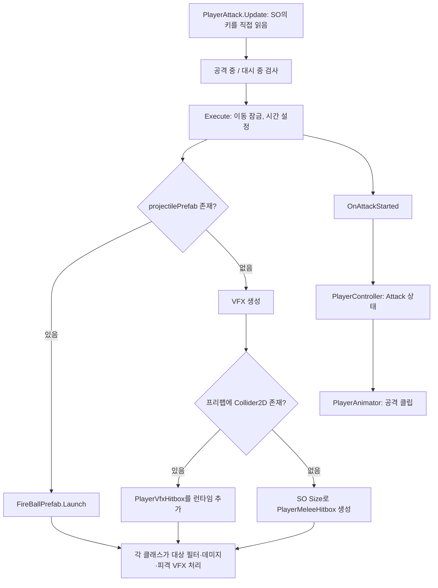

# 플레이어 공격 구조 검토

검토일: 2026-10-02. 기준 체크아웃: `fc9ee3f`.

코드, 저장된 SO, 프리팹, Animator Controller, 애니메이션 클립, 씬 YAML, 호출부를 읽어 확인했다. Unity Play 재현이나 컴파일 검사는 실행하지 않았다. 아래의 동작 결과는 코드 경로와 저장된 설정으로 판단한 것이며, 실제 화면의 증상과 프레임 순서는 추가 재현이 필요하다. 기존 소스·씬·프리팹·SO는 수정하지 않았다.

## 판단

SO 도입 자체보다 공격의 설정과 실행 책임을 SO와 프리팹에 중복으로 둔 채, 기존 판정 경로를 대체 경로로 계속 유지한 것이 핵심 문제다. 현재 SO는 런타임 상태를 저장하거나 런타임에 수정하지 않으므로, 공유 SO의 상태 오염을 원인으로 지목할 근거는 없다.

공격을 구분하는 기준도 섞였다. attackType은 식별·중복 경고·디버그 색에 사용하지만, 실행 방식은 projectilePrefab의 유무와 VFX 내부 Collider2D의 존재로 결정한다. 설정창에서 보이는 공격 종류와 실제 동작을 결정하는 조건이 다르다.

## 현재 연결

관련 파일: [PlayerAttack](../../Assets/02.Scripts/Player/Attack/PlayerAttack.cs), [공격 SO](../../Assets/02.Scripts/Player/Attack/PlayerAttackDataSO.cs), [플레이어 프리팹](../../Assets/03.Prefabs/Player/Player.prefab).

공유 Player.prefab의 공격 연결은 다음과 같다. 이름의 Left/Right는 별도 공격 이름이며 FacingDirection과 같은 의미라고 단정할 수 없다.

| SO | 키 | enum | 실제 생성 경로 | SO 판정 Size 적용 |
|---|---|---|---|---|
| LeftHorizontalAttack | 1 | SideAttack | VFX PolygonCollider2D | 안 됨 |
| RightHorizontalAttack | E | Horizontal | VFX CapsuleCollider2D | 안 됨 |
| DownAttack | 2 | Down | VFX PolygonCollider2D | 안 됨 |
| UpAttack | 3 | Up | VFX PolygonCollider2D | 안 됨 |
| FireBallAttack | R | Stab | FireBallPrefab + CircleCollider2D | 안 됨 |

현재 5개 SO의 Duration은 모두 0.22초, damage는 모두 10이다. Collider2D가 없는 근접 대체 경로는 이 기본 연결에서는 사용되지 않는다.

## 우선 수정할 기능 문제

### 1. High — 보스가 공격 대상에서 제외된다

PlayerMeleeHitbox.cs:31, PlayerVfxHitbox.cs:40, FireBallPrefab.cs:90은 접촉한 콜라이더의 태그가 Enemy일 때만 처리한다. [설인 프리팹](../../Assets/03.Prefabs/EliteMonster/EliteMonster_SnowGiant.prefab)의 Hurtbox는 138~139행에서 Boss 태그이며, Health는 보스 루트에 있다. 따라서 Health를 부모에서 찾는 처리까지 도달하지 않는다. 저장된 씬의 태그 override에서도 Enemy로 바꾸는 설정은 찾지 못했고, 프로젝트 스크립트의 런타임 tag 대입도 찾지 못했다.

수정 방향: Enemy/Boss 명칭에 흩어진 조건 대신 공격 가능한 피격 대상을 하나의 규칙으로 식별한다. 보스의 공격용 콜라이더까지 피해 대상으로 취급하지 않도록 hurtbox 구분도 함께 유지한다. 보스 전체를 Enemy 태그로 바꾸는 일괄 변경은 권하지 않는다.

### 2. High — 사망·피격 중 공격 시작을 막지 않는다

PlayerAttack.cs:51~80의 시작 조건은 IsAttacking과 IsDashing뿐이다. PlayerHit.IsHit, Health.IsDead, PlayerController의 Death 상태를 확인하지 않는다. PlayerHit.cs:73~88도 공격을 취소하거나 공격 컴포넌트를 비활성화하지 않는다.

사망 후 공격 키를 누르면 Execute와 OnAttackStarted가 실행될 수 있고, PlayerController.cs:141~145의 ChangeState(Attack)가 Death 상태를 덮어쓴다. EvaluateState의 Death 검사만으로는 이 이벤트 경로를 막을 수 없다. 피격 중 공격 시작은 넉백 속도도 변경한다.

수정 방향: 공격 허용 조건을 한 곳에서 적용하고, 피격·사망 시 공격 중단 정책을 명시한다. 피격 시 공격을 유지하는 기획이라도 사망 입력 차단은 별도로 필요하다.

### 3. High — 공격 취소가 생성한 공격 판정을 취소하지 않는다

PlayerAttack.cs:169~175는 IsAttacking과 이동 잠금만 해제한다. 생성된 공격 객체 참조를 보관하지 않으므로 근접 콜라이더와 VFX 판정은 자체 Duration이 끝날 때까지 남는다. 현재 착지 시 PlayerController.cs:126이 CancelAttack을 호출해도 이 판정은 취소되지 않는다.

수정 방향: 진행 중인 공격 인스턴스를 추적해 상태 종료와 판정 종료를 연결한다. 이미 발사한 화염구가 취소 후 남는 것은 별도 기획 정책으로 둘 수 있지만, 근접 판정까지 같은 이유로 방치하면 안 된다.

### 4. High — VFX 좌우 반전과 콜라이더 반전이 다르다

PlayerAttack.cs:153~159 → VFXFlip.cs:8~20은 SpriteRenderer.flipX와 VFXOffset.x만 바꾼다. PolygonCollider2D의 점과 Collider2D.offset, Transform 방향은 바뀌지 않는다. LeftHorizontalAttack, UpAttack 등의 현재 폴리곤은 x 방향으로 비대칭이다.

따라서 왼쪽 공격에서 그림과 실제 판정 모양이 달라진다. 화염구는 FireBallPrefab.cs:38~42에서 Transform Scale을 뒤집으므로 다른 반전 규칙을 쓴다. [Unity 공식 flipX 문서](https://docs.unity3d.com/6000.3/Documentation/ScriptReference/SpriteRenderer-flipX.html)도 flipX가 렌더링에만 영향을 준다고 설명한다.

수정 방향: 공격 루트 또는 전용 자식의 Transform 반전으로 그림·콜라이더를 함께 처리하고, 프리팹의 기본 방향과 Offset 반전 규칙을 하나로 정한다. SO의 방향 오프셋까지 두 번 반전하지 않도록 구분한다.

### 5. Medium — 여러 행동이 같은 이동 잠금 bool을 덮어쓴다

PlayerMove.cs:45~52의 단일 bool을 Attack, Dash, Hit, Wall이 각자 설정한다. 공격 종료는 무조건 false를 쓰고, PlayerWall.cs:82는 대시만 확인한 뒤 잠금을 푼다. PlayerHit의 ReleaseKnockbackLock은 공격을 검사하지만 반대 방향의 보호는 없다.

예: 공격 중 피격으로 넉백 잠금이 시작된 뒤 기존 공격 타이머가 먼저 끝나면 EndAttack이 넉백 잠금까지 풀 수 있다. 벽 점프 잠금과 공격 잠금도 같은 충돌을 갖는다.

수정 방향: 행동 허용/이동 제한을 상태 조정 담당이 결정하거나, 잠금 원인을 구분해 자신의 잠금만 해제한다.

## 설정·책임 중복과 레거시

### 6. Medium — SO Size를 수정해도 현재 공격 범위가 바뀌지 않는다

PlayerAttack.cs:109~112는 VFX에 Collider2D가 하나라도 있으면 임시 박스 생성을 건너뛴다. 실제 판정은 프리팹의 모양·Size·offset·Scale을 사용한다. 그런데 PlayerAttackEditor.cs:24~27은 SO의 Size로 박스를 그린다.

예: RightHorizontalAttack SO Size는 1.4×1.2지만 실제 CapsuleCollider2D는 Size 1.22×0.48, offset (0, 0.41)이다. 일반 편집용 표시와 실제 판정이 다르며, 화염구도 SO Size가 판정에 적용되지 않는다.

수정 방향: 프리팹 콜라이더를 기준으로 삼으면 SO Size와 임시 박스 경로를 제거하고 편집 표시도 실제 프리팹을 따른다. SO가 범위를 소유한다면 반대로 프리팹 판정을 자동으로 사용하는 경로를 제거한다. 둘을 암묵적으로 전환하지 않는다.

### 7. Medium — 위치 오프셋의 책임과 적용 시점이 중복된다

SO hitbox.Offset은 스폰 위치를 정한다. VFXOffset.cs:7은 Start에서 생성한 객체 전체를 다시 이동한다. 프리팹 Collider2D.offset은 그 안에서 판정 중심을 이동한다. VFXFlip은 별도로 VFXOffset.x를 반전한다.

현재 공격 VFX 4개의 VFXOffset 값은 모두 0이므로, 지금 그 값이 이중 이동을 일으킨다고 단정하지 않는다. 다만 중복 설정 기능은 실제로 존재하며, 값을 넣으면 VFX와 그 콜라이더 전체가 추가로 이동한다. 프리팹 콜라이더 debug bounds는 Start 이전에 캡처되므로 추가 이동을 반영하지 못한다.

Collider2D.offset 자체는 프리팹 내부의 모양을 맞추는 정상적인 설정일 수 있다. 제거 대상은 서로 같은 역할을 맡은 SO 스폰 이동과 VFX 루트의 추가 이동이다. 시각 보정이 필요하면 그림 전용 자식 Transform에 적용해 판정까지 옮기지 않는다.

### 8. Medium — 공격 시간·판정 시간·연출 시간이 섞였다

PlayerAttack.cs:75는 hitbox.Duration을 이동 잠금과 공격 상태의 전체 시간으로도 쓴다. 판정과 VFX는 키 입력 직후 즉시 생성되고, 준비 시간/활성 구간/회복 구간은 구분하지 않는다. 관련 공격 클립의 Animation Event는 모두 비어 있다.

현재 Animator Controller의 재생 속도까지 반영하면 LeftHorizontalAttack은 약 0.2216초, Right/Down/Up은 0.25초, FireBallAttack은 0.25초이다. SO의 공격 상태는 0.22초에 종료한다. 공격 VFX는 약 0.385~0.42초이고 OneShotVFX가 오디오 길이와 추가 지연까지 포함해 별도로 생존 시간을 정한다.

수정 방향: 플레이어 행동 시간, 데미지가 유효한 구간, 연출 객체 수명을 구분한다. 이를 Animation Event 또는 한 타임라인 중 하나로 관리하고, 오디오 길이 변경이 판정이나 조작 제한을 바꾸지 않도록 한다. 효과음 때문에 객체 수명이 길어지는 것 자체는 정상일 수 있다.

### 9. Medium — 근접/원거리 분기가 설정 누락을 다른 공격으로 바꾼다

projectilePrefab이 비면 같은 SO가 근접 공격이 된다. 연결돼 있어도 IPlayerProjectile이 없으면 PlayerAttack.cs:88~93에서 근접 공격으로 대체한다. VFX에 콜라이더를 추가하거나 제거해도 다른 판정 구현이 선택된다. 설정 실수와 의도한 공격 타입을 구분하지 않는다.

잘못된 투사체에 별도 VFX까지 설정하면 FireProjectile과 SpawnMeleeHitbox에서 VFX가 두 번 생성되는 경로도 있다. 현재 FireBallAttack의 vfxPrefab은 비어 있으므로 이 이중 생성은 현재 기본 설정에서 발생한다고 주장하지 않는다.

수정 방향: 모든 공격을 동일한 생성·초기화 경로로 만들고, 프리팹 내부에서 정지/추적/이동 동작을 구성한다. 잘못된 설정은 검증 오류로 처리한다. 서로 다른 이동 동작은 유지하되 피해 적용 절차를 공유한다.

### 10. Medium — 데미지 처리와 연출 호출이 세 구현에 복제됐다

PlayerMeleeHitbox.cs:29~37, PlayerVfxHitbox.cs:38~46, FireBallPrefab.cs:87~99에 태그 검사 → Health 탐색 → TakeDamage → 피격 VFX 호출이 반복된다. 앞의 둘은 HashSet으로 같은 Health의 중복 타격을 막고 IsDead/damage도 검사한다. 화염구는 같은 보호를 사용하지 않아, 이미 죽은 대상이나 피해를 적용하지 못한 접촉에도 피격 연출을 내거나 소멸할 수 있다.

수정 방향: 공통 피해 판정 컴포넌트가 대상 식별과 공격별 중복 타격 정책을 관리한다. 이동과 소멸 연출은 별도 동작으로 둔다. 현재 Dummy와 EliteMonsterDeath가 사망 연출을 담당하므로, 공격 쪽에 사망 연출을 다시 추가해 중복시키지 않는다.

### 11. Medium — 입력과 실행 책임이 PlayerAttack에 함께 있다

이동·점프·대시는 PlayerInput의 이벤트를 쓰지만, 공격만 PlayerAttack.Update가 SO의 KeyCode를 직접 읽는다. SO는 공격 파라미터뿐 아니라 키 배치, 애니 상태 문자열, VFX, 투사체 프리팹, 스폰/판정 정보까지 갖는다.

PlayerAttack은 입력 선택, 상태/이동 제어, 프리팹 구성 검사, 생성, 판정 구현 선택, 디버그 정보를 모두 담당한다. 각 책임의 변경 이유가 달라 기획 변경을 여러 위치에 반영해야 한다. 현재 클래스 전체를 여러 매니저로 쪼개는 것보다 입력·행동 조정·공격 객체/판정을 먼저 분리하는 것이 적절하다.

### 12. Medium — 버프의 공격력·공격속도 연결이 없다

AttackDamageUp/AttackSpeedUp enum과 SO는 있지만, 공격 실행은 so.damage와 hitbox.Duration을 그대로 사용한다. BuffPool.GetTotalValue의 사용처를 전체 게임 스크립트에서 찾지 못했다. 버프를 뽑고 보관하는 것과 공격에 적용하는 것이 연결되지 않은 상태다.

버프가 현 기획에 남아 있다면 통합 누락이다. 폐기된 기획이면 제거 후보이지, 이 검토만으로 버프 공식을 새로 구현할 근거는 없다. 플레이어별 최종 공격 값을 계산해 인스턴스에 넘기고 원본 SO를 직접 수정하지 않는 방향이 맞다.

### 13. Low — Stab 이름과 기본 생성기가 현 데이터와 다르다

FireBallAttack.asset의 attackType은 Stab이다. PlayerAttackType, IPlayerProjectile 관련 debug 변수, StabProjectile.controller, StabAttackVFX.anim에 찌르기 명칭이 남아 있다. 이는 이름의 불일치이며, 해당 controller/anim은 화염구에 실제로 참조되므로 이름만 보고 삭제하면 안 된다.

PlayerAttackDataGenerator는 현재 SO 폴더와 다른 Assets/07.Datas/Player/Attacks에 과거 이름·숫자키/키패드 키의 기본 세트를 만든다. 현재 연결된 SO는 1/2/3/E/R을 쓴다. 생성기는 현재 설정을 이관하거나 갱신하지 않는다. 공격 목록이 이미 있으면 자동 연결을 생략하므로 현 목록을 즉시 덮어쓰는 버그라고 주장하지 않는다.

SO 목록의 Header는 콤보 확장을 설명하지만, 실제로는 한 공격이 끝나기 전 다른 입력을 받지 않고, 콤보 단계/연계 창/입력 버퍼 구현도 없다. 현 시점에서 목록은 키별 공격 목록이다.

### 14. Low — EffectManager의 제거된 공격 필드가 저장된 YAML에 남았다

현재 EffectManager.cs에는 공격별 VFX 필드와 PlayAttack 함수가 없다. 그런데 FX/EffectManager.prefab, MainTestScene, HyunseoScene, MinsuScene에는 _attackBasicVfx/_attackSideAttackVfx, _attackStabVfx 등 과거 필드가 남아 있다. 현재 공격 생성은 SO 경로다.

이 저장 흔적을 현재 두 매니저가 동시에 공격을 생성하는 증거로 해석하면 안 된다. 공격 필드를 제거한 뒤 씬/프리팹 직렬화 정리가 따라오지 않은 상태로 보인다. 참조를 확인한 뒤 관련 자산만 정상 저장하며 정리할 후보이다.

## 추가 검증할 항목

- 현재 공격 VFX 4개에는 Rigidbody2D가 없고, 임시 PlayerMeleeHitbox에는 kinematic Rigidbody2D를 자동 추가한다. 현재 Dummy/설인은 dynamic Rigidbody2D라서 이것만으로 현재 모든 근접 공격이 실패한다고 할 수 없다. Rigidbody2D 없는 대상까지 지원할 경우 프리팹 판정 경로의 물리 전제가 달라진다. [Unity 트리거 문서](https://docs.unity3d.com/6000.3/Documentation/ScriptReference/MonoBehaviour.OnTriggerEnter2D.html) 참조.
- 화염구는 Update에서 Transform으로 이동하며 프리팹 Collision Detection은 Discrete이다. 빠른 이동 시 얇은 대상 누락은 Play에서 검증할 항목이다.
- 화염구는 terrainGrace 안의 지형 Enter를 무시하며 Stay 검사가 없다. 유예 중 들어간 지형에 계속 겹치면 유예가 끝나도 새 Enter가 생기지 않아 지형 소멸 처리가 빠질 수 있다. 스폰 겹침 보호와 앞으로 만날 벽의 충돌 무시를 구분해야 한다.
- 화염구 사거리는 32지만 speed 15 × lifetime 2는 약 30이다. 따라서 디버그에 그리는 32가 정상 설정의 실제 최대 이동 범위와 일치하지 않는다. 프레임 단위 종료로 작은 오차도 있다.
- Player 스케일은 1.5, 화염구 스케일은 5이고, 스폰 Offset은 월드 단위 덧셈이다. 플레이어 스케일과 함께 공격 범위가 변하는 기획인지 확인해야 한다. 지금 값을 임의로 같게 바꿀 근거는 없다.
- 근접 공격 객체는 플레이어 자식으로 생성되거나 추적하지 않는다. 공중 공격 중 몸이 이동해도 판정은 생성한 월드 위치에 남는다. 의도한 동작인지는 현 기획 확인이 필요하다.
- PlayerAnimator.PlayState(Attack)는 기본 공격을 재생하고, Controller는 다시 SO의 공격 이름을 재생한다. 공격 애니 선택 책임이 중복된다. 현재 기본 공격의 재시작과 다른 공격 선택 흐름을 함께 확인한 뒤 한 경로로 정리한다.

## 권장 정리 방향

모든 공격을 하나의 입력 요청 → 공격 허용 검사 → 선택한 공격 프리팹 생성/초기화 → 공통 피해 판정 흐름으로 맞춘다. 근접과 원거리를 상위 컨트롤러가 별개의 시스템으로 판별할 필요는 없다. 화염구에 이동 동작이 필요한 차이는 공격 객체 내부에 남긴다.

| 담당 | 책임 | 제외할 책임 |
|---|---|---|
| PlayerInput | 공격 요청과 키 배치 | 데미지·콜라이더·연출 |
| 플레이어 행동 조정 | 공격 가능 여부, 시작/종료/취소, 이동 제한 | 프리팹 내부 콜라이더 탐색으로 타입 추측 |
| 공격 정의 | 공격 프리팹, 기본 공격값, 행동 시간, 스폰 위치 | 런타임 상태, 키 배치, 사용되지 않는 대체 판정 Size |
| 공격 인스턴스 | 공격의 활성 구간, 소유자/방향/값, 취소 처리 | 플레이어의 키 입력 |
| 공통 피해 판정 | 피격 대상 식별, 피해 적용, 중복 타격 정책 | 이동 속도, 오디오 길이, 카메라 흔들림 |
| 선택적 이동/연출 | 화염구 이동, 그림·소리·페이드 | 다른 공격의 상태 종료 |

SO는 위의 작은 공격 정의로 유지할 수도 있고, PlayerAttack의 직렬화된 설정으로 옮길 수도 있다. 다섯 공격을 한 플레이어에서만 쓰는 현재 규모라면 SO 제거도 가능하다. 어느 쪽이든 SO만 삭제하고 같은 중복 필드를 Inspector로 옮기면 문제는 그대로 남는다.

권장 순서:

1. 현재 다섯 공격의 모양·위치·속도·키·애니·오디오 연결을 이관 기준으로 보존한다.
2. 보스 대상 필터, 사망/피격 입력, 공격 취소, 그림/판정 반전을 우선 고친다.
3. 판정 모양은 프리팹 콜라이더처럼 하나의 기준으로 정하고 공통 피해 처리를 적용한다. 임시 박스 대체 경로와 암묵적 타입 추정을 걷어낸다.
4. 입력과 상태 조정을 정리하고 시간의 의미를 나눈다. 잠금 충돌과 점프/착지/피격 조합을 검증한다.
5. 기획에서 유지하는 버프/콤보를 확인한 뒤 연결하거나 제거한다. 마지막에 생성기·이름·직렬화 잔재를 정리한다.

최소 Play 검증은 다섯 공격의 좌우 방향, Dummy/보스 명중, 한 공격의 중복 타격, 피격/사망/착지 취소, 벽 점프 잠금, 화염구 벽 충돌이다. 단순 컴파일 성공만으로 이관 완료라고 판단하면 안 된다.
